# MiniCPM4-0.5B 三值 QAT 与 bitnet.cpp 原生推理

## 从量化感知训练、模型转换到 x86 端侧部署的完整实践

日期：2026-11-19  
读者：具有 PyTorch、Transformer 和基本 C/C++ 基础，希望系统理解低比特 QAT 与推理引擎适配的工程师和学生  
范围：MiniCPM4-0.5B 三值预训练 QAT、ROW/G32 两种 checkpoint、Microsoft bitnet.cpp 的 vendored llama.cpp/GGML x86 CPU 适配与验证  
配套材料：[完整实验记录](reports/pretrain_v2/mix_v3_bitcpm/EXPERIMENT_NOTES.md)、[QAT 教学笔记](reports/QAT_TEACHING_NOTES.md)、[独立部署报告](reports/pretrain_v2/mix_v3_bitcpm/BITNET_CPP_DEPLOYMENT.md)

> 本文所有实验数字都来自本目录下已经保存的 `metrics.jsonl`、JSON 和日志。代码片段引用当前本地实现。本文不复述 SFT 主线，也不把本地 x86 结果外推到 ARM、Metal 或 CUDA。

---

## 阅读路线

- **30 分钟速读**：第 1 章 → 第 5 章 → 第 6.3 节 → 第 7.2 节 → 第 8 章 → 第 10 章。
- **60 分钟技术分享**：第 1–2 章 10 分钟，第 3–4 章 15 分钟，第 5–7 章 20 分钟，第 8–9 章 10 分钟，第 10 章 5 分钟。
- **代码教学**：重点阅读第 2.3、3.2、6.2、6.4、7.3–7.5、8.6 节，并打开对应源码链接。

---

# 1. 项目背景与最终成果

## 1.1 要解决的不是一个单纯的“压缩”问题

把一个 0.5B 模型变成三值权重，表面上只需执行：

```text
W → Q(W) ∈ {-s, 0, +s}
```

但要让它真正可用，必须同时回答三个不同层面的问题：

| 层面 | 核心问题 | 失败时的表现 |
|---|---|---|
| 训练 | 量化后怎样保持语言建模能力？ | 直接三值化导致 CE 和下游能力崩溃 |
| 模型交付 | 训练时的 `Q(W)` 怎样无损变成部署格式？ | scale 粒度错误、重复量化、张量排列错误 |
| 推理系统 | 2-bit 权重怎样参与真实矩阵计算？ | 只能存不能算、kernel 结果错误、性能没有收益 |

因此，本项目不是“训练结束后再随便找一个量化格式装进去”，而是建立一条完整链路：

> **训练语义 → checkpoint → 中间模型表示 → GGUF 物理编码 → 原生 CPU kernel → 分层数值证据。**

## 1.2 项目目标与硬约束

### 目标

1. 在 MiniCPM4-0.5B 上完成三值 QAT，并保留两种已经训练好的 checkpoint。
2. 同时支持 per-output-row 和 per-group-32 两种原生量化粒度。
3. 在 Microsoft bitnet.cpp 中完成真实 x86 CPU 推理，而不是只做模型转换。
4. 验证 kernel、GGUF、HF logits、固定窗口 CE、真实生成、吞吐和内存。

### 硬约束

- 不为了适配推理引擎而重训模型。
- 不修改既有 checkpoint 的训练量化语义。
- 不把 ROW checkpoint 转成 G32，也不把 G32 转成 ROW。
- 保留 legacy per-tensor `I2_S`，避免破坏官方 BitNet 兼容路径。
- 第一版只实现并验证 x86 CPU，不声称支持其他后端。

## 1.3 最终结果总览

| checkpoint / 格式 | 原生 HF 四域 macro CE | llama.cpp macro CE | 差值 | GGUF 大小 | 16 线程 CLI 生成 | 64 线程稳态 decode |
|---|---:|---:|---:|---:|---:|---:|
| `mix_v2_qat_70_15_15` / `I2_S_ROW` | 1.897251 | **1.899053** | +0.001801 | 662.171 MiB | 62.7 tok/s | 133.395 tok/s |
| `mix_v3_bitcpm_pg32` / `I2_S_G32` | 1.884792 | **1.886447** | +0.001655 | 703.866 MiB | 51.8 tok/s | 128.685 tok/s |

两种模型都完成了：

- 24 层 × 7 个投影，共 **168 个三值投影**；
- 每个 GGUF **221 个张量**的回读验证；
- prefill、cached decode 和真实 greedy 生成；
- 四域各 256 个固定 2048-token 窗口，每域 **524,288** 次 next-token 预测；
- scalar/AVX2/VNNI、多线程、吞吐和峰值内存测试。

**结论：两种部署都保持了原 checkpoint 的量化粒度和模型精度。** ROW/G32 来自不同训练 run，它们之间的质量差异不能解释成“只改变存储格式”的因果效果。

## 1.4 端到端总图

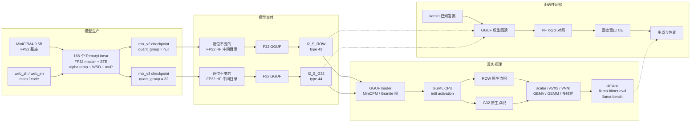

这张图也是全文目录：第 2–4 章讲模型生产，第 5–6 章讲模型交付，第 7 章讲真实推理，第 8–9 章讲证据。

---

# 2. 三值量化基础

## 2.1 三值权重的定义

对一个量化区域 `g`，训练和部署共同遵循：

```text
s_g = max(mean_{j in g}(|W_j|), 1e-8)
q_j = clamp(round(W_j / s_g), -1, 1)
Q(W)_j = q_j × s_g
stored_code_j = q_j + 1              # 存储值是 0/1/2
```

这里包含四个容易忽略的细节：

1. `absmean` 决定三值网格的间距。
2. `round` 后还要 `clamp`，大于 `+s` 的权重只能饱和到 `+s`。
3. `1e-8` 防止全零区域除零。
4. 内存里保存的是无符号 code `0/1/2`，计算时才恢复成 `q=-1/0/+1`。

### 一个可手算的 32 权重示例

假设一组 32 个权重由以下四类值各 8 个组成：

```text
W = [ 0.5 × 8个,  -0.25 × 8个,  0.125 × 8个,  0 × 8个 ]

sum(abs(W)) = 8 × (0.5 + 0.25 + 0.125) = 7
scale = 7 / 32 = 0.21875
```

| 原权重 | `W/scale` | round + clamp 后的 q | stored code | 部署权重 |
|---:|---:|---:|---:|---:|
| 0.5 | 2.2857 | +1 | 2 | +0.21875 |
| -0.25 | -1.1429 | -1 | 0 | -0.21875 |
| 0.125 | 0.5714 | +1 | 2 | +0.21875 |
| 0 | 0 | 0 | 1 | 0 |

这个例子说明：三值量化不是简单保留符号。`0.125` 因超过半阈值被量化为 `+1`，而 `0.5` 虽远大于 scale，也只能饱和到 `+1`。

## 2.2 per-tensor、per-row 和 per-group-32

本项目中的 **per-channel 明确指 per-output-row**：一个输出通道对应权重矩阵的一行。

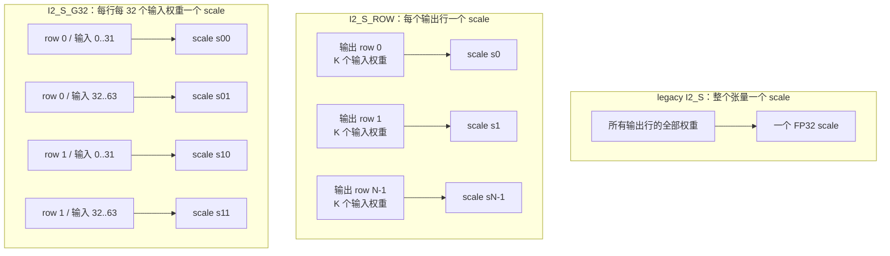

| 粒度 | scale 数量（N 行、每行 K 列） | 优点 | 代价 |
|---|---:|---|---|
| per-tensor | 1 | scale 开销最低 | 无法适应不同行和不同输入区域的动态范围 |
| per-output-row | N | 每个输出通道独立适配 | 每行一次 scale 读取和后处理 |
| per-group-32 | `N×K/32` | 更细的局部动态范围适配 | scale 存储、读取和逐组归约开销更高 |

## 2.3 训练量化器的真实代码

来源：[qat/quant.py:66-92](../qat/quant.py#L66-L92)

```python
def ternary_quantize(w: torch.Tensor, group_size=None):
    """Return (codes, scale) for a 2-D weight.

    Per-group mode returns codes [rows, groups, group_size] and scale [rows, groups, 1].
    Legacy per-row mode returns codes [rows, cols] and scale [rows, 1].
    """
    if w.ndim != 2:
        raise ValueError(f'ternary_quantize expects a 2-D weight, got shape {tuple(w.shape)}')
    g = _quant_group if group_size is None else group_size
    if g is None:
        scale = w.abs().mean(dim=1, keepdim=True).clamp(min=EPS)
        return (w / scale).round().clamp(-1, 1), scale
    g = int(g)
    x, mask = _grouped(w, g)
    if mask is None:
        scale = x.abs().mean(dim=2, keepdim=True)
    else:
        scale = (x.abs() * mask).sum(dim=2, keepdim=True) / mask.sum(dim=2, keepdim=True).clamp(min=1)
    scale = scale.clamp(min=EPS)
    return (x / scale).round().clamp(-1, 1), scale


def ternary_dequant(w: torch.Tensor, group_size=None) -> torch.Tensor:
    rows, cols = w.shape
    codes, scale = ternary_quantize(w, group_size)
    return (codes * scale).reshape(rows, -1)[:, :cols]
```

教学重点：

- ROW 在 `dim=1` 上归约，scale 为 `[rows,1]`。
- G32 先 reshape 为 `[rows,groups,32]`，在 `dim=2` 上归约。
- 训练器允许尾部 padding，并用 mask 排除 padding；当前部署格式要求 K 是 32 的倍数，MiniCPM4 的 K=1024/4096 均满足。

## 2.4 为什么是 absmean，而不是 absmax

官方报告没有给出完整量化公式，因此项目对 BitCPM4-0.5B 权重做了逆向验证。粒度检查发现 group=16/32 时几乎所有组内非零权重只有一个绝对值，而 group=64 有 98.84% 的组违反该规律，因此真实粒度应为 32，16 只是 32 的约数而天然自洽。

scale 统计量通过零占比间接判断：

| 规则（group=32） | 零占比 |
|---|---:|
| 对原始 MiniCPM4 使用 absmean | 31.45% |
| 对原始 MiniCPM4 使用 absmax | 76.51% |
| BitCPM4 官方权重实测 | 34.95% |

absmean 明显更接近官方权重。需要注意：这是基于权重形态的逆向证据，不等于证明本项目公式与未公开的官方实现逐行相同。

## 2.5 为什么旧 `I2_S` 不能直接复用

旧 `I2_S` 是整张量一个 scale。把 G32 checkpoint 强行放进该路径后，四域 macro CE 从 **1.8848** 变为 **3.4265**。这不是可接受的浮点误差，而是部署语义已经改变。

所以正确方案不是修改训练结果去适应旧 kernel，而是新增：

- `GGML_TYPE_I2_S_ROW = 43`；
- `GGML_TYPE_I2_S_G32 = 44`；
- 对应的 GGUF file type、物理布局、量化器和原生计算路径。

---

# 3. 三值 QAT 如何训练

## 3.1 核心矛盾：round 不可导，但 master 必须持续更新

直接执行 `round()` 时，梯度几乎处处为零。QAT 使用 straight-through estimator（STE）：前向显式计算量化权重，反向把量化近似为恒等映射。

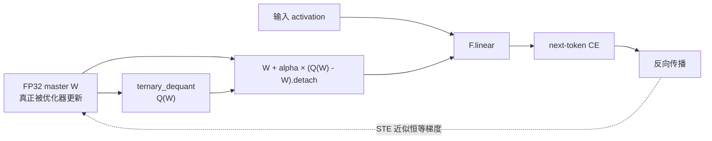

前向实际权重是：

```text
W_fwd = (1-alpha) × W + alpha × Q(W)
```

- `alpha=0`：纯浮点前向；
- `0<alpha<1`：浮点和三值之间的渐进插值；
- `alpha=1`：部署时的纯三值前向。

由于 `(Q(W)-W)` 被 `detach`，对 master 的梯度仍通过第一个 `W` 透传，微小的 FP32 更新不会在每一步被三值网格吞掉。

## 3.2 `TernaryLinear` 的真实实现

来源：[qat/quant.py:95-108](../qat/quant.py#L95-L108)

```python
class TernaryLinear(nn.Linear):
    """nn.Linear whose forward weight is fake-quantized to ternary values."""

    def __init__(self, in_features, out_features, bias=False, device=None, dtype=None):
        super().__init__(in_features, out_features, bias=bias, device=device, dtype=dtype)
        self.register_buffer('alpha', torch.ones((), dtype=torch.float32), persistent=False)
        self.quantize = True

    def forward(self, x):
        w = self.weight
        if self.quantize:
            w_q = ternary_dequant(w.float()).to(w.dtype)
            w = w + self.alpha.to(w.dtype) * (w_q - w).detach()
        return F.linear(x, w, self.bias)
```

这一行是整个训练架构的枢纽：

```python
w = w + self.alpha.to(w.dtype) * (w_q - w).detach()
```

| 片段 | 作用 |
|---|---|
| `w_q - w` | 量化误差 `Q(W)-W` |
| `.detach()` | 切断量化误差分支的梯度，形成 STE |
| `alpha` | 控制量化误差的注入进度 |
| 最前面的 `w` | 保留到 FP32 master 的完整梯度路径 |

## 3.3 哪些层被量化

目标后缀为：

```python
TARGET_SUFFIXES = (
    'q_proj', 'k_proj', 'v_proj', 'o_proj',
    'gate_proj', 'up_proj', 'down_proj'
)
```

转换还要求模块路径包含 `.layers.`，因此：

- 24 层 × 7 投影 = **168 个矩阵**被替换为 `TernaryLinear`；
- `embed_tokens`、`lm_head`、norm 不在目标范围；
- 部署时 embedding、lm_head/output、norm 和 RoPE factors 继续保持 F32。

训练入口会检查实际替换数量，避免静默漏层。来源：[qat/train.py:296-304](../qat/train.py#L296-L304)

```python
model = load_model(cfg['model'], device, torch.float32)
model._alpha = 1.0
set_quant_group(cfg['quant_group'])
quant_suffixes = cfg.get('quant_suffixes') or list(quant.TARGET_SUFFIXES)
replaced = convert_to_ternary(model, suffixes=quant_suffixes)
assert len(replaced) == len(quant_suffixes) * model.config.num_hidden_layers, len(replaced)
```

## 3.4 alpha ramp 与 WSD 日程

来源：[qat/train.py:146-164](../qat/train.py#L146-L164)

```python
def lr_at(step, total, cfg):
    """WSD: linear warmup, constant, linear decay to min_lr_ratio over the final decay_frac."""
    warm = max(1, int(total * cfg['warmup_frac']))
    decay_start = int(total * (1 - cfg['decay_frac']))
    if step < warm:
        return (step + 1) / warm
    if step < decay_start:
        return 1.0
    frac = (step - decay_start) / max(1, total - decay_start)
    return 1.0 - frac * (1.0 - cfg['min_lr_ratio'])


def alpha_at(step, total, cfg):
    if cfg['alpha_ramp_tokens']:
        ramp = cfg['alpha_ramp_tokens'] // cfg['global_batch_tokens']
    else:
        ramp = int(total * cfg['alpha_ramp_frac'])
    return 1.0 if ramp <= 0 else min(1.0, step / ramp)
```

WSD 把训练分成 warmup、stable、decay；alpha ramp 则独立控制浮点到三值的过渡。两条日程不能混为一谈：

- LR 控制优化步长；
- alpha 控制前向权重离三值模型有多近；
- 最终比较必须在各自 LR decay 结束后进行，中途平台期数值不等于最终模型。

实验上，`mix_v1` 的 ramp=0.1 在约 102 步完成，梯度范数峰值达到 3.88；`mix_v2` 拉长到 0.3、约 572 步完成，峰值约为 1.5。

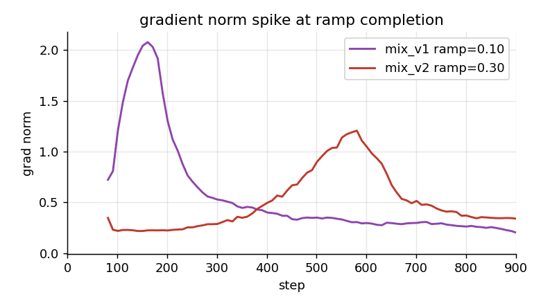

## 3.5 μP 参数分组

来源：[qat/train.py:125-143](../qat/train.py#L125-L143)

```python
def param_groups(model, cfg):
    """muP: hidden matrices get lr * dim_model_base / hidden_size; embeddings/norms get base lr."""
    conf = model.config
    scale = conf.dim_model_base / conf.hidden_size if cfg['mup_lr_scale'] else 1.0
    matrices, embed, other = [], [], []
    for name, p in model.named_parameters():
        if not p.requires_grad:
            continue
        if 'embed_tokens' in name or 'lm_head' in name:
            embed.append(p)
        elif p.ndim == 2:
            matrices.append(p)
        else:
            other.append(p)
    return [
        dict(params=matrices, lr_mult=scale, weight_decay=cfg['weight_decay'], name='matrices'),
        dict(params=embed, lr_mult=1.0, weight_decay=0.0, name='embed'),
        dict(params=other, lr_mult=1.0, weight_decay=0.0, name='norms'),
    ]
```

教学时只需抓住：隐藏矩阵、词表参数和其他参数使用不同的 LR 倍率与 weight decay，避免所有张量共享同一套优化尺度。

## 3.6 为什么 checkpoint 保存 FP32 master

来源：[qat/train.py:228-234](../qat/train.py#L228-L234)

```python
def save_checkpoint(raw_model, optimizer, step, tokens, cfg, tag):
    """Full training state (fp32 master weights + AdamW). Written to a temp file, then renamed."""
    path = Path(cfg['run_dir']) / 'checkpoints' / tag
    path.mkdir(parents=True, exist_ok=True)
    atomic_torch_save({'model': raw_model.state_dict(), 'optimizer': optimizer.state_dict(),
                       'step': step, 'tokens': tokens, 'config': cfg}, path / 'state.pt')
    return path
```

三值权重是 master 的确定性函数，保存 master 就能重建 `Q(W)`；同时还能恢复优化器、继续训练和做不同部署格式的严格校验。

**一个反直觉现象**：QAT 完成后，FP32 master 的浮点前向可能很差，因为它已经主要作为“生成正确三值权重的潜变量”被优化，而不是一个独立的高质量浮点模型。

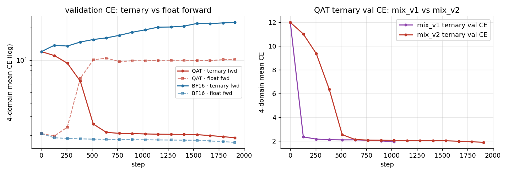

mix_v2 的真实数据：

| step | QAT 三值 CE | QAT 浮点 CE | BF16 直接三值 CE | BF16 浮点 CE |
|---:|---:|---:|---:|---:|
| 0 | 12.003 | 2.073 | 12.003 | 2.073 |
| 512 | 2.544 | 10.057 | 15.559 | 1.840 |
| 1024 | 2.058 | 9.853 | 19.144 | 1.815 |
| 1908 | **1.897** | 10.193 | 22.444 | **1.720** |

这同时证明两件事：QAT 模型必须用 `alpha=1` 三值前向评价；不做 QAT 而直接三值化浮点模型不可行。

## 3.7 验证代码如何避免评错精度

来源：[qat/train.py:202-218](../qat/train.py#L202-L218)

```python
def _eval_both(raw_model, cfg, device, world, rank):
    """Validation at deployed precision (ternary, alpha=1) and, for reference, in float."""
    res = {}
    if cfg['mode'] == 'qat':
        alpha = raw_model._alpha
        set_alpha(raw_model, 1.0)
        res['val_ternary'] = evaluate(raw_model, cfg, device, world, rank)
        set_alpha(raw_model, alpha)
        set_quantize(raw_model, False)
        res['val_float'] = evaluate(raw_model, cfg, device, world, rank)
        set_quantize(raw_model, True)
    else:
        res['val_float'] = evaluate(raw_model, cfg, device, world, rank)
        set_quantize(raw_model, True)
        res['val_ternary'] = evaluate(raw_model, cfg, device, world, rank)
        set_quantize(raw_model, False)
    return res
```

验证暂时改变 alpha/quantize 状态，完成后恢复；外层还保存并恢复 RNG，保证验证不会改变后续训练样本顺序。

---

# 4. 数据配比与逐轮训练改进

最终模型并不是一次配置直接训练得到的。整个过程依次回答了五类问题：优化超参怎么选、QAT 相比 BF16 损失多少、数据配比如何影响 CE 与下游能力、延长训练和渐进量化是否有效、更细量化粒度是否还有收益。每一轮都保留下一轮真正需要改变的变量，也保留无法严格归因的边界。

## 4.1 实验决策树

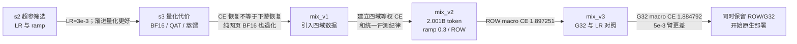

## 4.2 数据配比、数据池与统一评测口径

### 三种预训练配比分别验证什么

本项目中的“70/15/15”指网页总池 70%、数学 15%、代码 15%，网页内部再按中文和英文各半采样；“50/25/25”指网页总池 50%、数学 25%、代码 25%。它们不是中文 70%、英文 15%、数学 15%。

| 配比简称 | web_zh | web_en | math | code | 要回答的问题 |
|---|---:|---:|---:|---:|---|
| 纯网页 | 50% | 50% | 0% | 0% | 不加入数学和代码时，QAT 能恢复到什么程度？ |
| 70/15/15 | 35% | 35% | 15% | 15% | 适量数学和代码能否改善四域 CE 与能力保留？ |
| 50/25/25 | 25% | 25% | 25% | 25% | 继续提高数学和代码占比，是否还有额外收益？ |

### 数据池扩大与实际采样量

mix_v1 和 mix_v2 的 math/code 文件逐字节相同，网页则从 33 个分片扩到 109 个分片。下表同时列出池子大小和真实采样量，避免只写配比而看不出数据是否被重复使用。

| 域 | mix_v1 数据池 | mix_v2 数据池 | mix_v2 实际采样 / pass | mix_v3 每臂约需 / pass |
|---|---:|---:|---:|---:|
| web_zh | 600.002M | 1.840B | 699.468M / 0.380 | 0.787B / 0.428 |
| web_en | 600.001M | 1.920B | 699.849M / 0.365 | 0.787B / 0.410 |
| math | 350.000M | 350.000M | 300.063M / 0.858 | 0.337B / 0.963 |
| code | 350.000M | 350.000M | 301.304M / 0.861 | 0.337B / 0.968 |

mix_v3 总预算为 4.5B token，拆成两臂各 2.248B。若只跑一个 4.5B 臂，math/code 都需要约 1.93 pass；拆臂后每臂各域均不超过 1 pass，同时还能保留一个 LR 对照。这是训练预算由数据池约束的直接例子。

### 统一 CE 协议

- 原始 little-endian uint32 token stream；
- 每个窗口读取 2049 token：2048 inputs + 1 个 shifted target；
- 窗口互不重叠，位置从 0 开始，每窗清空 KV memory；
- 所有 prefill 位置请求 logits；
- 四域分别计算 CE，再做等权 macro；
- s2/s3 的中英网页 CE 与 mix_v1 之后的四域 CE 不是同一评价集，不能直接横向比较；
- 数据池、token 数或 LR 日程不同的终点，也不能把差值全部归因于量化配置。

## 4.3 第一次尝试：s2 的 8 组 LR × ramp 网格

s2 每组训练约 500M token，使用中英文网页各 50%，目的是先确定优化超参，而不是一开始就叠加数据、蒸馏和粒度改动。完整结果来自 [s2_screening.md](reports/s2_screening.md)。

| run | LR | alpha ramp | 中文三值 CE | 英文三值 CE | 平均三值 CE |
|---|---:|---:|---:|---:|---:|
| **s2_ramp0.1_lr3e-3** | **3e-3** | **0.1** | **3.159** | **2.924** | **3.041** |
| s2_ramp0_lr3e-3 | 3e-3 | 0 | 3.173 | 2.936 | 3.054 |
| s2_ramp0.1_lr1e-3 | 1e-3 | 0.1 | 3.198 | 2.948 | 3.073 |
| s2_ramp0_lr1e-3 | 1e-3 | 0 | 3.219 | 2.966 | 3.092 |
| s2_ramp0.1_lr1e-2 | 1e-2 | 0.1 | 3.315 | 3.077 | 3.196 |
| s2_ramp0_lr1e-2 | 1e-2 | 0 | 3.798 | 3.513 | 3.656 |
| s2_ramp0.1_lr3e-4 | 3e-4 | 0.1 | 3.419 | 3.123 | 3.271 |
| s2_ramp0_lr3e-4 | 3e-4 | 0 | 3.463 | 3.161 | 3.312 |

这一轮得到两个明确结论：

1. 在相同 LR 下，ramp=0.1 都比突然全量三值化更好；在 1e-2 时，改善尤其明显，说明渐进量化能缓冲优化冲击。
2. 3e-3 是网格中的最佳峰值 LR；3e-4 学不动，1e-2 又过于激进。因此后续先用 3e-3，不随着每次数据变化重新扫完整网格。

## 4.4 第二次尝试：s3 分离量化损失、数据损失与蒸馏收益

s3 仍使用纯网页 50/50，每组严格训练 943,718,400 token、900 步，使用相同数据顺序、batch 和 WSD 日程。它第一次同时放入 BF16 对照，使“QAT 的损失”不再用原始发布模型作为不恰当的唯一参照。完整记录见 [s3_comparison.md](reports/s3_comparison.md)。

### BF16、QAT 与原模型教师蒸馏

| 组 | 训练方式 | 峰值 LR | 教师 | 最终平均 CE |
|---|---|---:|---|---:|
| A1 | BF16 续训 | 3e-4 | — | 2.753 |
| **A2** | **BF16 续训** | **1e-3** | — | **2.715** |
| **B** | **三值 QAT，ramp=0.1** | **3e-3** | — | **2.970** |
| D | B + 蒸馏 | 3e-3 | 原始发布模型，权重 0.5 | 2.992 |
| E | B + 蒸馏 | 3e-3 | A2 BF16，权重 0.5 | 2.941 |
| E | B + 蒸馏 | 3e-3 | A2 BF16，权重 0.9 | 2.937 |

这里必须区分三个差值：B 比原始发布模型的 3.177 更低，不代表三值无损；B 与最佳同数据 BF16 A2 的差是 **+0.256 nats**，才是这一轮受控的量化代价；A2 自己虽然 CE 很好，但下游也明显下降，说明数据分布是另一条独立问题。

### 为什么蒸馏没有成为主线

原始模型教师的 CE 为 3.177，比学生 B 最终的 2.970 还差，D 因此反而退到 2.992，吞吐也只有 B 的约 57%。改用更好的 A2 教师后，两个 E 臂恢复到 2.941/2.937，说明教师质量确实重要；但它们仍明显差于 A2 的 2.715，而且没有对应的完整下游结果，因此只能得出“CE 有有限改善”，不能宣称能力已经恢复。

### 下游结果改变了数据路线

| 模型 | MMLU | CMMLU | C-Eval | 结论 |
|---|---:|---:|---:|---|
| 原始 MiniCPM4-0.5B | 50.5% | 66.4% | 68.0% | 发布模型基线 |
| A2：BF16 纯网页续训 | 44.0% | 46.7% | 49.6% | 不量化也明显退化 |
| B：QAT 纯网页续训 | 23.8% | 25.1% | 23.9% | CE 恢复但能力未恢复 |
| D：B + 原模型蒸馏 | 25.5% | 25.3% | 26.6% | 仍接近随机水平 |

下一步因此不是继续堆蒸馏，而是引入数学和代码数据，并始终保留 BF16 数据对照。另一个观察是 B−A2 的 CE 差距在 LR 衰减阶段继续缩小，支持后续增加训练量和重新检查 ramp 长度。

## 4.5 第三次尝试：mix_v1 同时比较三种数据配比

mix_v1 每组训练 1,073,741,824 token、1,024 步，LR=3e-3，QAT ramp=0.1。四组只改变模式或数据配比，第一次直接检验“加入数学和代码是否有效”。完整记录见 [mix_v1/EXPERIMENT_NOTES.md](reports/pretrain_v2/mix_v1/EXPERIMENT_NOTES.md)。

| 组 | 模式 | 网页 / 数学 / 代码 | web_zh | web_en | math | code | 四域 macro CE |
|---|---|---|---:|---:|---:|---:|---:|
| mix_v1_qat_web | QAT | 100% / 0% / 0% | 3.284 | 3.167 | 1.498 | 1.172 | 2.280 |
| **mix_v1_qat_70_15_15** | **QAT** | **70% / 15% / 15%** | **3.011** | **2.900** | **1.269** | **0.557** | **1.934** |
| mix_v1_qat_50_25_25 | QAT | 50% / 25% / 25% | 3.035 | 2.914 | 1.264 | 0.595 | 1.937 |
| mix_v1_bf16_70_15_15 | BF16 | 70% / 15% / 15% | 2.843 | 2.713 | 1.139 | 0.499 | 1.749 |

结果支持两个选择：

1. 加入数学和代码后，QAT macro CE 从纯网页的 2.280 降到 1.934，混合语料成为主线。
2. 70/15/15 与 50/25/25 只差 0.003，不能把数学/代码继续加倍解释为稳定收益，因此选择 70/15/15。

基础模型下游仍提示量化差距：QAT 70/15/15 的 MMLU/CMMLU/C-Eval 为 26.61%/25.47%/24.74%，BF16 同配比为 31.61%/30.73%/31.05%。未 SFT 的 GSM8K 全部顶到生成长度上限，不用于能力判断。

### mix_v1 的 GSM8K SFT 尝试

为了区分“格式不会停止”和“数学能力不足”，又在 6,973 条 GSM8K 训练数据上做 5 个 epoch 的答案-only SFT。500 条开发集结果如下：

| epoch | QAT strict | BF16 strict |
|---:|---:|---:|
| 1 | 7.60% | 21.80% |
| 2 | 11.40% | 25.80% |
| 3 | 14.00% | 28.60% |
| 4 | **14.40%** | **29.20%** |
| 5 | 12.00% | 27.40% |

两者都在第 4 轮最好。完整测试集上 QAT/BF16 SFT 的 GSM8K strict 分别为 11.60%/23.73%：SFT 明显修复了格式，但没有消除预训练阶段形成的推理能力差距。

## 4.6 第四次尝试：mix_v2 扩网页、加倍 token、拉长 ramp

mix_v2 保留 70/15/15 和 LR=3e-3，只做 QAT 与 BF16 两组；训练量从 1.074B 增至 2.001B，QAT ramp 从 0.1 延至 0.3，即约 572 步完成全三值过渡。与此同时网页池也扩大了，所以这一轮不是“只改 ramp”的严格单变量实验。完整记录见 [mix_v2/EXPERIMENT_NOTES.md](reports/pretrain_v2/mix_v2/EXPERIMENT_NOTES.md)。

| step | 已训 token | QAT 三值四域 CE | BF16 浮点四域 CE |
|---:|---:|---:|---:|
| 0 | 0 | 12.003 | 2.073 |
| 256 | 268M | 9.372 | 1.868 |
| 512 | 536M | 2.544 | 1.840 |
| 768 | 805M | 2.083 | 1.824 |
| 1024 | 1.074B | 2.058 | 1.815 |
| 1280 | 1.342B | 2.041 | 1.806 |
| 1536 | 1.611B | 2.027 | 1.800 |
| 1908 | 2.001B | **1.897** | **1.720** |

在相同 1,024 步，mix_v2 的 2.058 反而差于 mix_v1 的 1.934；继续到 1,908 步后才达到 1.897。结合网页分片已经变化，正确结论是“更长训练最终改善了 CE，拉长 ramp 后量化适应更充分”，而不能把全部 0.037 改善都归因于 ramp。

### 训练量翻倍为什么没有提升下游

| 指标 | mix_v1 QAT | mix_v2 QAT | mix_v1 BF16 | mix_v2 BF16 |
|---|---:|---:|---:|---:|
| MMLU | 26.61% | 24.29% | 31.61% | 29.03% |
| CMMLU | 25.47% | 25.04% | 30.73% | 27.10% |
| C-Eval | 24.74% | 24.96% | 31.05% | 28.31% |
| GSM8K strict | 0.83% | 1.74% | 13.04% | 9.25% |

QAT 与 BF16 的 MMLU 同步下降，说明不能把下降归因于三值量化。网页内容替换和容量分配是主要解释；CE 更低也不保证知识和推理能力同步提高。GSM8K 仍受未 SFT 停止行为影响，不参与质量结论。

## 4.7 第五次尝试：逐轮修改 SFT 数据，而不是把失败混成一次训练

以下实验都从 mix_v2 QAT 预训练模型出发，用于诊断通用指令、数学、代码和重复样本的影响。它们不是最终 bitnet.cpp 部署所用的两个预训练 checkpoint，但完整展示了数据配比如何一轮轮被修正。

### 先跑纯 GSM8K SFT，建立格式与正确率基线

mix_v2 纯 GSM8K SFT 使用 6,973 条数据、5 个 epoch。开发集 strict 依次为 QAT 10.20%/11.80%/13.40%/14.00%/14.00%，BF16 20.60%/23.80%/26.00%/24.60%/23.60%；因此 QAT 选第 4 轮，BF16 选第 3 轮。

### 每一轮 SFT 数据改动及真实结果

| 顺序 | 数据配方 | 关键改动 | 最优 epoch | GSM8K strict | 正常停止率 | MMLU | CMMLU | C-Eval |
|---:|---|---|---:|---:|---:|---:|---:|---:|
| 基线 | 纯 GSM8K，6,973 条 × 5 epoch | 只学习答题格式和数学监督 | 4 | **11.90%** | 92.3% | 24.79% | 24.38% | 27.12% |
| 1 | 纯通用指令，495,219 条 | 加入 Firefly、双语 Alpaca、HC3；不含 GSM8K | 3 | 3.56% | 66.0% | 24.88% | 25.25% | 26.82% |
| 2 | 通用 + GSM8K ×3，516,138 条 | GSM8K 占比 4.05%，补回停止格式 | 2 | 8.87% | 98.9% | 24.72% | 24.76% | 27.79% |
| 3 | sft_v2：通用 59.7% / 代码 25.0% / 数学 15.3% | 加代码，GSM8K 提高到 ×11 | 1 | 7.35% | 98.3% | 24.00% | 24.99% | 25.71% |
| 4 | sft_v3：通用 59.9% / 代码 25.1% / 数学 15.0% | GSM8K 降到 ×2，新增 60,834 条 UltraData-Math | 3 | **9.25%** | **99.1%** | **25.44%** | 24.86% | 26.30% |

逐轮解释如下：

1. **纯通用 SFT**：选择题几乎没有收益，GSM8K 从 11.90% 降到 3.56%。三轮纯通用数据稀释了 `####` 结尾和停止习惯，因此下一轮必须把 GSM8K 混回来。
2. **GSM8K ×3 混合**：停止率恢复到 98.9%，正确率从 3.56% 回到 8.87%，但仍低于纯 GSM8K 基线，说明格式恢复不等于数学能力恢复。
3. **代码 + GSM8K ×11**：dev CE 逐轮上升，最优停在 epoch 1；GSM8K 反降到 7.35%，MMLU/C-Eval 也下降。高重复导致过拟合，代码占比还挤占通用数据，而本轮没有 HumanEval/MBPP 来衡量代码收益。
4. **GSM8K ×2 + 多样数学**：dev CE 改为逐轮下降，GSM8K 回到 9.25%，MMLU 提高到 25.44%。这支持“降低重复、增加数学多样性”，但仍没有超过纯 GSM8K 的 11.90%，不能宣称通用能力问题已经解决。

这条 SFT 线的最终价值是明确数据配比和失败模式，而不是挑选一个部署模型。若继续，应优先调整数学/通用数据构成和重复次数，而不是简单增加 epoch。

## 4.8 第六次尝试：mix_v3 比较 G32 与两个 LR

在 mix_v2 ROW 之后，最后一轮预训练把总预算拆成两个 2.248B 臂，以便同时检查量化粒度和官方报告中的阶段二 LR。两臂保持 70/15/15，ramp=0.3，decay=0.2。完整记录见 [mix_v3_bitcpm/EXPERIMENT_NOTES.md](reports/pretrain_v2/mix_v3_bitcpm/EXPERIMENT_NOTES.md)。

| 臂 | 量化粒度 | LR | warmup | token | 要回答的问题 |
|---|---|---:|---:|---:|---|
| mix_v2 / ROW 参照 | per-output-row | 3e-3 | 2% | 2.001B | 已有最佳 ROW 基线 |
| **A：mix_v3_bitcpm_pg32** | **per-group-32** | **3e-3** | **2%** | **2.248B** | 更细粒度是否继续降低 CE？ |
| B：mix_v3_bitcpm_pg32_lr5e3 | per-group-32 | 5e-3 | 5% | 2.248B | 在当前单阶段预算下，更高 LR 是否更好？ |

### 训练过程中的逐步变化

| step | alpha | v2 ROW | A G32 3e-3 | B G32 5e-3 |
|---:|---:|---:|---:|---:|
| 0 | 0.00 | 12.003 | 10.645 | 10.645 |
| 128 | 0.20 | 11.029 | 9.991 | 9.629 |
| 256 | 0.40 | 9.372 | 8.515 | 8.482 |
| 384 | 0.60 | 6.373 | 6.071 | 6.634 |
| 512 | 0.80 | 2.544 | 3.363 | 3.441 |
| 640 | **1.00** | 2.131 | 2.161 | 2.197 |
| 768 | 1.00 | 2.083 | 2.077 | 2.131 |
| 1024 | 1.00 | 2.058 | 2.045 | 2.088 |
| 1280 | 1.00 | 2.041 | 2.030 | 2.066 |
| 1536 | 1.00 | 2.027 | 2.025 | 2.048 |
| 1908 | 1.00 | **1.897** | — | — |
| 2144 | 1.00 | — | **1.885** | **1.900** |

0–640 步是量化适应期，640 步后进入全三值平台期，最后 20% 是 LR 衰减。A 在多数等步位置略优于 v2，B 则持续差于 A；最终值必须等各自 decay 结束后再取。

### 不同训练长度不能直接归因

| 日程进度 | v2 ROW | A G32 | B G32 5e-3 | A−v2 | B−A |
|---:|---:|---:|---:|---:|---:|
| 0.3 | 2.544 | 2.161 | 2.197 | −0.383 | +0.036 |
| 0.5 | 2.074 | 2.045 | 2.088 | −0.029 | +0.043 |
| 0.7 | 2.041 | 2.025 | 2.048 | −0.016 | +0.024 |
| 0.9 | 1.987 | 1.956 | 1.977 | −0.031 | +0.021 |
| 1.0 | 1.897 | 1.885 | 1.900 | −0.013 | +0.016 |

A 比 v2 多训练约 12% token，而且没有保留可严格等 token 对比的中途快照，所以“粒度更细”和“训练更多”仍不能完全分离。日程归一化和恒定 LR 平台期等步对比都显示 A 只小幅更好，不能把 G32 描述成数量级改进。

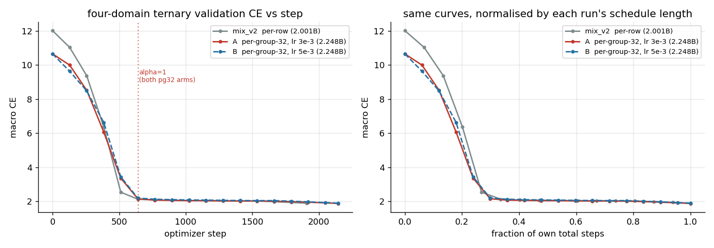

### 最终各域与下游结果

| 域 | v2 ROW | A G32 3e-3 | B G32 5e-3 |
|---|---:|---:|---:|
| web_zh | 2.955 | 2.937 | 2.956 |
| web_en | 2.859 | 2.846 | 2.866 |
| math | 1.244 | 1.233 | 1.248 |
| code | 0.532 | 0.524 | 0.531 |
| **四域平均** | **1.897** | **1.885** | **1.900** |

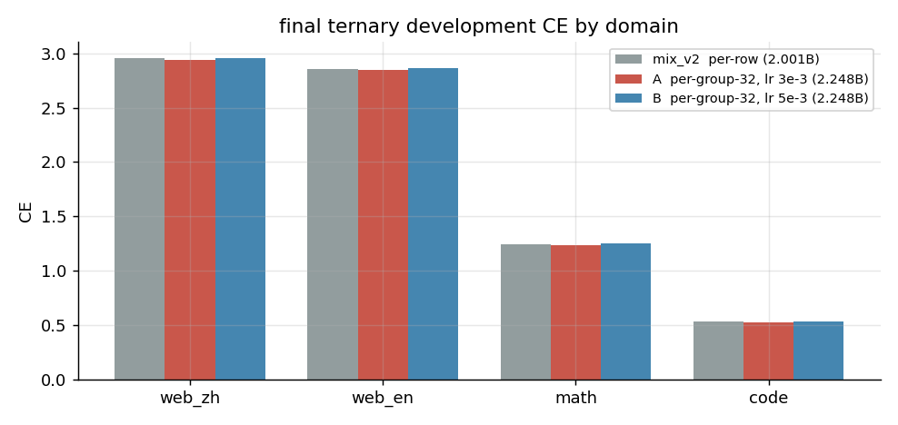

| 指标 | v2 ROW | A G32 3e-3 | B G32 5e-3 |
|---|---:|---:|---:|
| MMLU | 24.29% | **25.54%** | 25.65% |
| CMMLU | 25.04% | 25.13% | 24.48% |
| C-Eval | 24.96% | 25.19% | 23.70% |

A 相对 v2 的 MMLU 提高 1.25pp，按二项近似 z=3.43；但它同时多训练了约 12% token。CMMLU/C-Eval 的差异在噪声范围内，B 的更高 LR 也没有带来下游优势。

## 4.9 所有尝试之后，最终保留什么

- **优化配置**：s2 选择 LR=3e-3 和渐进量化，mix_v2/mix_v3 将 ramp 延长到 0.3。
- **预训练数据**：选择网页 70% / 数学 15% / 代码 15%，网页内部中英各半；50/25/25 没有显示稳定收益。
- **蒸馏**：原模型教师不划算，BF16 教师只带来有限 CE 改善，不作为主线。
- **SFT 路线**：用于诊断数据与能力，不作为本次两个 base checkpoint 的部署来源；高重复 GSM8K 和纯通用覆盖都不是解决方案。
- **保留 mix_v2 ROW**：它是已有的最佳 per-row checkpoint，原生 HF 四域 macro CE 为 1.897251。
- **保留 mix_v3 G32**：它的四域 macro CE 为 1.884792，代表另一种原生粒度。
- **不采用 5e-3 臂**：在当前 2.248B 单阶段设定下，它始终差于 3e-3 臂；这不是对官方完整两阶段配方的否定。
- **下一步优先级**：扩充数据总量和多样性，而不是继续微调粒度或 LR；官方 350B token 与本实验 2.248B 相差约 175 倍。
- **部署纪律**：不再修改训练量化器去适配 bitnet.cpp，部署阶段只负责忠实执行既有 Q(W)。

---

# 5. 从训练模型到部署模型的总体架构

## 5.1 四个架构面

| 架构面 | 核心组件 | 输出 | 必须保持的契约 |
|---|---|---|---|
| 模型生产 | 数据采样、`TernaryLinear`、STE、alpha ramp、WSD、μP | FP32 master checkpoint | 训练配置唯一决定量化粒度 |
| 模型交付 | 导出器、HF 中间目录、F32 GGUF、`llama-quantize` | 原生 ROW/G32 GGUF | 不重复量化，不交叉转换，不改变模型图 |
| 推理执行 | GGUF loader、GGML type traits、int8 activation、ROW/G32 dot | logits 和生成 token | 物理 stride、scale 位置和归约方式一致 |
| 证据评测 | known-answer、roundtrip、logits、CE、CLI、bench | 可追溯的 JSON、日志和曲线 | 同输入、同窗口、同协议，区分数值与性能测试 |

## 5.2 训练 fake-quant 与部署真实计算的对应关系

| 训练阶段 | 部署阶段 | 不变量 |
|---|---|---|
| FP32 master `W` | F32 GGUF 中的 master 权重 | 在部署量化前保持完整 FP32 信息 |
| `ternary_quantize(W)` | C++ `quantize_i2_s_scaled` | absmean、round、clamp、eps 和粒度一致 |
| `codes×scale` 得到浮点 `Q(W)` | packed 2-bit code + FP32 scale | 表示的是同一个离散权重，而非新的训练量化方式 |
| BF16 autocast 的 `F.linear` | int8 activation × 三值权重的原生点积 | 目标是 logits/CE 对齐，不声称端到端数值路径完全相同 |
| HF prefill / DynamicCache decode | llama.cpp prefill / KV cache decode | 输入 token、位置和 shifted target 一致 |

**架构边界：训练量化器与部署 kernel 共享数学语义，但不共享全部数值实现。** activation 量化和浮点归约差异必须单独报告。

## 5.3 哪些共享，哪些必须分开

| 可以复用 | 必须按粒度分开 |
|---|---|
| MiniCPM/Granite 计算图、tokenizer、KV cache | GGML 类型编号和 GGUF file type |
| int8 activation workspace 和量化入口 | 每行 scale 数量、scale 偏移和物理 stride |
| 2-bit 高位优先打包方式 | ROW 整行归约与 G32 逐组归约 |
| GEMV/GEMM 外层遍历和多线程机制 | 每组 activation correction 和 scale 读取 |
| scalar、AVX2、VNNI 的整数语义 | 不同 SIMD 指令的具体实现 |

这种划分避免了两个极端：为两种格式复制整套推理栈，或者为了复用旧路径而牺牲 checkpoint 语义。

## 5.4 为什么不反过来修改训练量化器

模型训练完成后，checkpoint 和对应 run config 已经成为事实上的数值契约。若为了让旧 `I2_S` 能加载而修改训练量化器，会带来三个问题：

1. 已完成的训练不再对应部署模型，需要重训才能严格评价。
2. 历史 ROW/G32 checkpoint 无法保持各自粒度。
3. 旧的精度结果、下游结果和曲线失去可比性。

因此新增部署类型是更小、更正确的工程改动：**让推理系统适应模型，而不是让模型适应一个语义不符的旧格式。**

---

# 6. 模型导出与 GGUF 格式设计

## 6.1 完整转换链

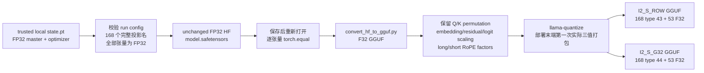

HF 目录只是转换中间产物，不是把 master 当成高质量 dense 模型发布。真正的 2-bit 编码只发生在最后一步。

## 6.2 导出器如何阻止交叉转换

来源：[tools/export_bitnet_hf.py:104-118](../tools/export_bitnet_hf.py#L104-L118)

```python
def _validate_granularity(run_config_path, granularity):
    with run_config_path.open(encoding="utf-8") as handle:
        config = json.load(handle)
    if not isinstance(config, dict):
        raise ValueError(f"Run config must contain a JSON object: {run_config_path}")

    group = config.get("quant_group")
    if granularity == "row":
        if group is not None:
            raise ValueError(
                f"--granularity row requires missing quant_group or null, got {group!r}"
            )
    elif type(group) is not int or group != 32:
        raise ValueError(f"--granularity g32 requires quant_group exactly 32, got {group!r}")
    return group
```

导出器还检查：

- 输出目录必须不存在，拒绝覆盖已有产物；
- checkpoint 中必须包含 `model` state dict；
- 每个张量必须为 FP32；
- 必须恰好存在 168 个完整目标投影；
- safetensors 原子写入后重新打开，逐张量 `torch.equal`；
- manifest 明确记录 `quantization_applied: False`。

核心流程见[tools/export_bitnet_hf.py:205-259](../tools/export_bitnet_hf.py#L205-L259)。

## 6.3 为什么不能先导出 `0,±s` 再量化

如果 checkpoint 中的某行 master 经训练量化得到：

```text
Q(W) = {0, -s, +s}
```

再对这些三值权重计算 absmean，会得到：

```text
mean(|Q(W)|) = s × nonzero_density
```

而不是原来的 `s`。第二次量化会使用错误尺度，改变三值权重分布。这就是必须坚持以下顺序的原因：

```text
FP32 master
  → 不变的 FP32 HF / F32 GGUF
  → 按目标原生粒度只量化一次
```

## 6.4 两种 GGUF 的物理行布局

每 4 个 2-bit code 打包为 1 byte，字节内从高位到低位存放：

```text
byte = code[i] << 6 | code[i+1] << 4 | code[i+2] << 2 | code[i+3]
```

两种格式的行布局如下：

```text
I2_S_ROW，每行 K 个权重
┌──────────────────────────────┬──────────────────┐
│ K/4 bytes packed 2-bit codes │ 1 × FP32 scale   │
└──────────────────────────────┴──────────────────┘
row_bytes = K/4 + 4


I2_S_G32，每行 K 个权重，K/32 组
┌──────────────────────────────┬─────────┬─────────┬──────┬─────────────┐
│ K/4 bytes packed 2-bit codes │ group 0 │ group 1 │ ...  │ group K/32-1│
│                              │ FP32    │ FP32    │      │ FP32        │
└──────────────────────────────┴─────────┴─────────┴──────┴─────────────┘
row_bytes = K/4 + 4 × K/32
```

两者都不使用 legacy `I2_S` 的 32-byte trailer。

来源：[ggml.c:1370-1382](../bitnet.cpp/3rdparty/llama.cpp/ggml/src/ggml.c#L1370-L1382)

```c
size_t ggml_row_size(enum ggml_type type, int64_t ne) {
    assert(type >= 0);
    assert(type < GGML_TYPE_COUNT);
    assert(ne % ggml_blck_size(type) == 0);
    if (type == GGML_TYPE_I2_S_ROW) {
        GGML_ASSERT(ne % 4 == 0);
        return ne/4 + sizeof(float);
    }
    if (type == GGML_TYPE_I2_S_G32) {
        GGML_ASSERT(ne % 32 == 0);
        return ne/4 + (ne/32)*sizeof(float);
    }
    return ggml_type_size(type)*ne/ggml_blck_size(type);
}
```

`ggml_nbytes`、tensor stride、GGUF offset、loader、量化返回值和 kernel 必须使用同一个物理行大小，否则即使点积公式正确，也会读到错误权重。

## 6.5 C++ 打包代码与训练量化器的对应

来源：[quants.c:1390-1420](../bitnet.cpp/3rdparty/llama.cpp/ggml/src/ggml-cpu/quants.c#L1390-L1420)

```c
static size_t quantize_i2_s_scaled(const float * src, void * dst, int64_t nrow, int64_t n_per_row, bool per_group) {
    assert(n_per_row % 32 == 0);

    const int64_t groups = per_group ? n_per_row/32 : 1;
    const size_t row_size = n_per_row/4 + groups*sizeof(float);

    for (int64_t row = 0; row < nrow; ++row) {
        const float * src_row = src + row*n_per_row;
        uint8_t * qrow = (uint8_t *)dst + row*row_size;
        float * scales = (float *)(qrow + n_per_row/4);
        memset(qrow, 0, row_size);

        for (int64_t group = 0; group < groups; ++group) {
            const int64_t begin = per_group ? group*32 : 0;
            const int64_t end = per_group ? begin + 32 : n_per_row;
            float sum = 0.0f;
            for (int64_t i = begin; i < end; ++i) {
                sum += fabsf(src_row[i]);
            }
            const float scale = fmaxf(sum/(float)(end - begin), 1e-8f);
            scales[group] = scale;

            for (int64_t i = begin; i < end; ++i) {
                float q = nearbyintf(src_row[i]/scale);
                q = fmaxf(-1.0f, fminf(1.0f, q));
                const uint8_t code = (uint8_t)((int)q + 1);
                qrow[i/4] |= code << (6 - 2*(i%4));
            }
        }
    }
    return nrow*row_size;
}
```

`per_group=false` 时整个输出行是一个区域，即 ROW；`true` 时每 32 个权重是一个区域，即 G32。两者共享实现，但 `groups`、scale 地址和 `begin/end` 明确保持各自语义。

## 6.6 张量构成与实际模型大小

| 产物 | 字节数 | 大小 | 说明 |
|---|---:|---:|---|
| 任一 F32 GGUF | 2,038,028,928 | 1943.616 MiB | 转换中间产物 |
| ROW GGUF | **694,336,128** | **662.171 MiB** | payload 660.56 MiB，10.88 BPW |
| G32 GGUF | **738,056,832** | **703.866 MiB** | payload 702.25 MiB，11.57 BPW |

每个量化 GGUF：

```text
221 tensors = 168 个新类型投影 + 53 个 F32 张量
```

219 个 HF 权重之外的两个张量是转换生成的 long/short RoPE factors。embedding、lm_head/output、norm 和 RoPE factors 保留 F32，因此整模型有效 BPW 远高于三值投影本身的 2 bit。

G32 比 ROW 多 43,720,704 bytes，约 **6.30%**，主要来自每 32 个权重保存一个 FP32 scale。

---

# 7. x86 原生推理 kernel

## 7.1 一次目标投影的完整数据流

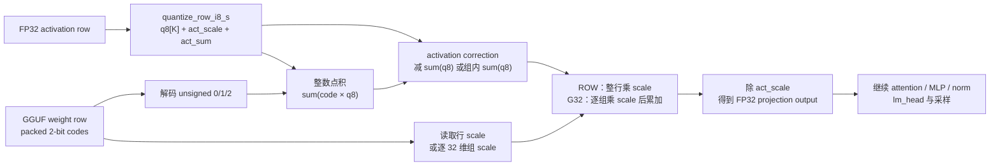

这不是 weight-only 数值误差的端到端证明：目标投影的 activation 仍量化为 int8，其他张量和输出路径也各有浮点实现。

## 7.2 从 code 到三值点积：关键推导

存储 code 与真实三值 q 的关系是：

```text
q_i = code_i - 1
```

因此：

```text
Σ(q_i × q8_i)
= Σ((code_i - 1) × q8_i)
= Σ(code_i × q8_i) - Σ(q8_i)
```

这使 kernel 可以把 code 当作 unsigned 0/1/2，与 signed int8 activation 使用 VNNI/AVX2 整数点积，再减去 activation sum 恢复真实三值结果。

### ROW 后处理

```text
result = (code_sum - act_sum) × row_scale / act_scale
```

### G32 后处理

```text
result = Σ_g[(group_code_sum_g - group_act_sum_g) × group_scale_g] / act_scale
```

G32 不能只减整行 `act_sum` 后乘一个统一 scale；每个 32 维组必须在乘自己的 scale 前完成修正。

## 7.3 activation 量化与多线程准备

来源：[ggml-cpu.c:1427-1455](../bitnet.cpp/3rdparty/llama.cpp/ggml/src/ggml-cpu/ggml-cpu.c#L1427-L1455)

```c
// I2_S needs extra space for activation scales and sums
float * act_scales = NULL;
int32_t * act_sums = NULL;
if (src0->type == GGML_TYPE_I2_S || src0->type == GGML_TYPE_I2_S_ROW || src0->type == GGML_TYPE_I2_S_G32) {
    act_scales = (float *) ((char *) wdata + (ne11 * ne10));
    act_sums = (int32_t *) ((char *) act_scales + (ne11) * sizeof(float));
}

// ...
for (int64_t i13 = 0; i13 < ne13; ++i13) {
    for (int64_t i12 = 0; i12 < ne12; ++i12) {
        if (src0->type == GGML_TYPE_I2_S || src0->type == GGML_TYPE_I2_S_ROW || src0->type == GGML_TYPE_I2_S_G32) {
            // I2_S: distribute rows across threads (each row needs full-row amax/sum)
            for (int64_t i11 = ith; i11 < ne11; i11 += nth) {
                quantize_row_i8_s(
                    (float *)((char *) src1->data + i13*nb13 + i12*nb12 + i11*nb11),
                    (void *) (wdata + i13*nbw3 + i12*nbw2 + i11*nbw1),
                    ne10, act_scales + i11, act_sums + i11);
            }
        }
```

三种 I2_S 路径共享 activation workspace，但新格式不再在最后统一乘 legacy tensor scale。

## 7.4 ROW/G32 的原生点积实现

### ROW：整行整数归约后乘一个 scale

来源：[quants.c:1492-1516](../bitnet.cpp/3rdparty/llama.cpp/ggml/src/ggml-cpu/quants.c#L1492-L1516)

```c
void ggml_vec_dot_i2_i8_s_row(int n, float * s, const void * vx, const void * vy, float act_scale, int32_t act_sum) {
    const uint8_t * x = (const uint8_t *)vx;
    const int8_t * y = (const int8_t *)vy;
    if (act_scale == 0.0f) {
        *s = 0.0f;
        return;
    }
    const float weight_scale = *(const float *)(x + n/4);
#if defined(__AVX2__)
    __m256i acc = _mm256_setzero_si256();
    for (int group = 0; group < n/32; ++group) {
        const __m256i codes = ggml_i2_s_decode32_avx2(x + group*8);
        const __m256i activations = _mm256_loadu_si256((const __m256i *)(y + group*32));
        acc = ggml_i2_s_dpbusd(acc, codes, activations);
    }
    const int32_t code_sum = ggml_i2_s_hsum_epi32(acc);
#else
    int32_t code_sum = 0;
    for (int i = 0; i < n; ++i) {
        const int code = (x[i/4] >> (6 - 2*(i%4))) & 0x03;
        code_sum += code*y[i];
    }
#endif
    *s = (float)(code_sum - act_sum)*weight_scale/act_scale;
}
```

### G32：每 32 维修正、乘组 scale、按组累加

来源：[quants.c:1518-1550](../bitnet.cpp/3rdparty/llama.cpp/ggml/src/ggml-cpu/quants.c#L1518-L1550)

```c
void ggml_vec_dot_i2_i8_s_g32(int n, float * s, const void * vx, const void * vy, float act_scale, int32_t act_sum) {
    const uint8_t * x = (const uint8_t *)vx;
    const int8_t * y = (const int8_t *)vy;
    const float * weight_scales = (const float *)(x + n/4);
    (void)act_sum;
    if (act_scale == 0.0f) {
        *s = 0.0f;
        return;
    }
    assert(n % 32 == 0);
    float sum = 0.0f;
    for (int group = 0; group < n/32; ++group) {
#if defined(__AVX2__)
        const __m256i codes = ggml_i2_s_decode32_avx2(x + group*8);
        const __m256i activations = _mm256_loadu_si256((const __m256i *)(y + group*32));
        const __m256i zero = _mm256_setzero_si256();
        const int32_t code_sum = ggml_i2_s_hsum_epi32(ggml_i2_s_dpbusd(zero, codes, activations));
        const int32_t group_act_sum = ggml_i2_s_hsum_epi32(
            ggml_i2_s_dpbusd(zero, _mm256_set1_epi8(1), activations));
#else
        int32_t code_sum = 0;
        int32_t group_act_sum = 0;
        for (int j = 0; j < 32; ++j) {
            const int i = group*32 + j;
            const int code = (x[i/4] >> (6 - 2*(i%4))) & 0x03;
            code_sum += code*y[i];
            group_act_sum += y[i];
        }
#endif
        sum += (float)(code_sum - group_act_sum)*weight_scales[group];
    }
    *s = sum/act_scale;
}
```

两段代码是整份分享最值得逐行讲解的部分：它们直接体现了物理布局、量化粒度和计算归约三者的一一对应。

## 7.5 AVX2 与 VNNI

来源：[quants.c:1482-1489](../bitnet.cpp/3rdparty/llama.cpp/ggml/src/ggml-cpu/quants.c#L1482-L1489)

```c
static inline __m256i ggml_i2_s_dpbusd(__m256i acc, __m256i a, __m256i b) {
#if defined(__AVXVNNI__) || (defined(__AVX512VNNI__) && defined(__AVX512VL__))
    return _mm256_dpbusd_epi32(acc, a, b);
#else
    return _mm256_add_epi32(acc,
        _mm256_madd_epi16(_mm256_maddubs_epi16(a, b), _mm256_set1_epi16(1)));
#endif
}
```

| 路径 | 核心指令 | 作用 |
|---|---|---|
| AVX-VNNI / AVX512-VNNI | `_mm256_dpbusd_epi32` | unsigned code × signed int8，直接累加到 int32 |
| AVX2 回退 | `_mm256_maddubs_epi16` + `_mm256_madd_epi16` | 用两条指令实现同类整数点积 |
| scalar | 2-bit 解包和整数循环 | 无 AVX2 时的语义回退与参考 |

AVX2 解码一次处理 32 个 code：读取 8 个 packed bytes，通过 nibble 查表展开为 32 个 unsigned bytes。优化只改变指令实现，不改变上述数学语义。

## 7.6 GEMV、GEMM 与分发

GGML 在 vec-dot 路径中按 `src0->type` 选择对应函数。来源：[ggml-cpu.c:1273-1293](../bitnet.cpp/3rdparty/llama.cpp/ggml/src/ggml-cpu/ggml-cpu.c#L1273-L1293)

```c
if (src0->type == GGML_TYPE_I2_S_ROW || src0->type == GGML_TYPE_I2_S_G32) {
    const float * act_scales = (const float *)((const char *)wdata + ne11*ne10);
    const int32_t * act_sums = (const int32_t *)((const char *)act_scales + ne11*sizeof(float));
    for (int64_t ir1 = ir1_start; ir1 < ir1_end; ++ir1) {
        const int64_t i13 = ir1/(ne12*ne1);
        const int64_t i12 = (ir1 - i13*ne12*ne1)/ne1;
        const int64_t i11 = ir1 - i13*ne12*ne1 - i12*ne1;
        const int64_t i03 = i13/r3;
        const int64_t i02 = i12/r2;
        const char * src1_col = (const char *)wdata + (i11 + i12*ne11 + i13*ne12*ne11)*row_size;
        float * dst_col = (float *)((char *)dst->data + i11*nb1 + i12*nb2 + i13*nb3);
        for (int64_t ir0 = ir0_start; ir0 < ir0_end; ++ir0) {
            const uint8_t * x = (const uint8_t *)src0->data + i02*nb02 + i03*nb03 + ir0*nb01;
            if (src0->type == GGML_TYPE_I2_S_ROW) {
                ggml_vec_dot_i2_i8_s_row(ne00, dst_col + ir0, x, src1_col, act_scales[i11], act_sums[i11]);
            } else {
                ggml_vec_dot_i2_i8_s_g32(ne00, dst_col + ir0, x, src1_col, act_scales[i11], act_sums[i11]);
            }
        }
    }
    return;
}
```

二维 `ggml_gemm_i2_i8_s_scaled` 使用同一组 dot 函数，并显式传入 weight/activation stride。测试覆盖了：

- GEMV 和多列 GEMM；
- K={32,64,128,256}；
- rows={1,3,5} 与行/列尾部；
- 零 activation；
- 物理 stride 和 `ggml_nbytes`；
- 真实三线程 GGML 图；
- legacy `I2_S` 回归。

---

# 8. 如何证明部署是正确的

## 8.1 六层证据链

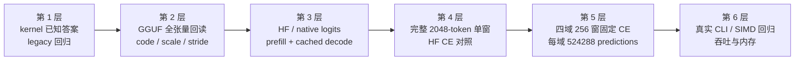

每一层只回答一类问题。前一层失败时先修前一层，不用端到端生成掩盖底层错误。

## 8.2 第 1 层：kernel 已知答案与 legacy 回归

最终 SIMD 二进制真实输出：

```text
ok: GGML CPU mul_mat i2_s K=128 rows=5 cols=4 threads=3
ok: GGML CPU mul_mat i2_s_row K=128 rows=5 cols=5 threads=3
ok: GGML CPU mul_mat i2_s_g32 K=128 rows=5 cols=5 threads=3
all scaled I2_S known-answer tests passed
```

完整日志：[test_i2s_scaled.log](reports/pretrain_v2/mix_v3_bitcpm/bitnet_cpp/test_i2s_scaled.log)  
测试源码：[test-i2s-scaled.cpp](../bitnet.cpp/3rdparty/llama.cpp/tests/test-i2s-scaled.cpp)

这层同时覆盖新格式和旧 `I2_S`，避免新类型接入时改变官方 BitNet 的 legacy 行为。

## 8.3 第 2 层：GGUF 全张量回读

验证器对每个 GGUF 的全部 221 个张量检查 shape、类型、物理字节数、Q/K permutation、code、scale 和 F32 精确值。

| 指标 | ROW | G32 |
|---|---:|---:|
| 量化 / 精确 F32 张量 | 168 / 53 | 168 / 53 |
| 非边界 code mismatch | **0** | **0** |
| FP32 half-threshold code 差异 | 205 | 29 |
| 最大边界归一化偏差 | 9.5367e-7 | 8.9407e-8 |
| 最大 scale 绝对误差 | 2.0117e-7 | 8.9407e-8 |
| 最大 scale 相对误差 | 4.6271e-6 | 5.3194e-7 |
| code 相同时最大权重误差 | 2.0117e-7 | 8.9407e-8 |

准确结论不是“全部 code bitwise-identical”，而是：

- 所有非半阈值位置完全一致；
- 所有边界翻转均已计数；
- 最大边界归一化距离不超过 9.54e-7；
- 差异来自 C++ 与 PyTorch FP32 reduction-order；
- 边界翻转导致的一档三值权重差，不能与同 code 的 scale 误差混为一谈。

结果：[ROW roundtrip](reports/pretrain_v2/mix_v3_bitcpm/bitnet_cpp/mix_v2_row_roundtrip.json)、[G32 roundtrip](reports/pretrain_v2/mix_v3_bitcpm/bitnet_cpp/mix_v3_g32_roundtrip.json)  
代码：[verify_bitnet_gguf.py](../tools/verify_bitnet_gguf.py)

## 8.4 第 3 层：HF/native logits 对齐

协议：web_zh 原始 token，32-token prefill + 8 个 cached decode 位置，vocab=73,448。HF 使用 FP32 master、168 个 TernaryLinear、`alpha=1`、DynamicCache 和 CUDA BF16 autocast；native 使用 int8 activation。

| 40 位置总体指标 | ROW | G32 |
|---|---:|---:|
| max absolute logit error | 1.295019 | 1.681273 |
| mean absolute logit error | 0.101823 | 0.087666 |
| RMSE | 0.135220 | 0.124521 |
| argmax agreement | 95.0% | 97.5% |
| native CE | 4.573949 | 4.564454 |
| HF CE | 4.566381 | 4.531025 |
| prefill argmax agreement | 93.75% | 100% |
| cached-decode argmax agreement | 100% | 87.5% |

最大单 logit 误差必须结合 int8 activation、BF16 autocast 和浮点累加顺序理解，不能当作纯权重回读误差。40 个位置只用于执行路径对齐，不用于评价整体模型质量。

结果：[ROW logits](reports/pretrain_v2/mix_v3_bitcpm/bitnet_cpp/mix_v2_row_logits_comparison.json)、[G32 logits](reports/pretrain_v2/mix_v3_bitcpm/bitnet_cpp/mix_v3_g32_logits_comparison.json)  
代码：[compare_bitnet_logits.py](../tools/compare_bitnet_logits.py)

## 8.5 第 4 层：完整 2048-token 单窗对照

域为 web_zh、window=0，使用 2048 个 shifted targets：

| 模型 | HF CE | llama.cpp CE | 差值 |
|---|---:|---:|---:|
| ROW | 3.570723 | 3.573723 | +0.003000 |
| G32 | 3.541007 | 3.540195 | −0.000812 |

这一步排除了“只有 32-token 短序列能对齐”的假象。结果保存在[full_window_hf_check.json](reports/pretrain_v2/mix_v3_bitcpm/bitnet_cpp/full_window_hf_check.json)。

## 8.6 第 5 层：完整固定窗口 CE

### evaluator 如何保证窗口协议

来源：[bitnet-eval.cpp:154-175](../bitnet.cpp/3rdparty/llama.cpp/tools/bitnet-eval/bitnet-eval.cpp#L154-L175)

```cpp
for (int window = 0; window < opt.windows; ++window) {
    llama_memory_clear(llama_get_memory(ctx), false);
    const size_t offset = size_t(window) * (opt.seq_len + 1);
    llama_batch batch = llama_batch_init(opt.seq_len, 0, 1);
    for (int i = 0; i < opt.seq_len; ++i) {
        batch.token[i] = llama_token(tokens[offset + i]);
        batch.pos[i] = i;
        batch.n_seq_id[i] = 1;
        batch.seq_id[i][0] = 0;
        batch.logits[i] = 1;
    }
    batch.n_tokens = opt.seq_len;
    const auto prefill_start = std::chrono::steady_clock::now();
    const int status = llama_decode(ctx, batch);
    prefill_seconds += std::chrono::duration<double>(std::chrono::steady_clock::now() - prefill_start).count();
    if (status != 0) throw std::runtime_error("prefill failed with status " + std::to_string(status));
    const float * logits = llama_get_logits(ctx);
    const token_metrics prefill = measure_logits(logits, tokens.data() + offset + 1, opt.seq_len, vocab);
    ce_sum += prefill.ce;
    correct += prefill.correct;
    predictions += opt.seq_len;
    if (!opt.logits_out.empty()) write_logits(logits_stream, ctx, opt.seq_len, vocab);
    llama_batch_free(batch);
```

这里明确做到：每窗清 KV、位置重置、原始 token 不重新 tokenize、全部位置输出 logits、target 右移一位。cached decode 是另一个独立测试路径，不混入这八组完整 CE。

### 八组真实结果

| 模型 | 域 | 原生 HF CE | llama.cpp CE | llama − HF | llama top-1 |
|---|---|---:|---:|---:|---:|
| ROW | web_zh | 2.954505 | **2.956743** | +0.002238 | 46.0934% |
| ROW | web_en | 2.858753 | **2.860963** | +0.002210 | 44.0302% |
| ROW | math | 1.243507 | **1.245192** | +0.001685 | 71.3264% |
| ROW | code | 0.532241 | **0.533313** | +0.001072 | 86.0779% |
| **ROW** | **四域 macro** | **1.897251** | **1.899053** | **+0.001801** | — |
| G32 | web_zh | 2.937009 | **2.939107** | +0.002098 | 46.2677% |
| G32 | web_en | 2.845672 | **2.847640** | +0.001968 | 44.1811% |
| G32 | math | 1.232789 | **1.234289** | +0.001500 | 71.4926% |
| G32 | code | 0.523697 | **0.524752** | +0.001055 | 86.2673% |
| **G32** | **四域 macro** | **1.884792** | **1.886447** | **+0.001655** | — |

每组均校验 `windows=256`、`sequence_length=2048`、`decode_steps=0`、`token_predictions=524288`，八组任务均 exit=0。原始汇总：[ce_summary.json](reports/pretrain_v2/mix_v3_bitcpm/bitnet_cpp/ce_summary.json)。

这些 CE 任务曾以 8×24 线程并发运行，耗时包含 CPU 和内存带宽争用，因此只能用于数值验证，不能作为性能结果。

## 8.7 第 6 层：真实生成与 SIMD 数值回归

真实 `llama-cli` 路径验证了模型加载、prompt prefill、逐 token cached decode、采样和退出，而不只是专用 evaluator。

SIMD 优化前后，两份 40×73,448 FP32 logits 文件逐字节一致：

| 模型 | SHA256（缩写） | 比较结果 |
|---|---|---|
| ROW | `dd13f809…9589` | 完全一致 |
| G32 | `f36b3805…dd7a` | 完全一致 |

日志：[simd_logits_regression.log](reports/pretrain_v2/mix_v3_bitcpm/bitnet_cpp/simd_logits_regression.log)。这证明对于这些固定输入，SIMD 没有改变数值输出。

## 8.8 误差应该归因到哪一层

| 观察到的差异 | 合理归因 | 不应作出的结论 |
|---|---|---|
| 同 code 的 scale 微小差异 | C++/PyTorch FP32 reduction-order | 部署换了量化规则 |
| half-threshold code 翻转 | 临界位置的微小 reduction 差异 | 任意权重都存在大规模 code 错误 |
| 短序列最大 logit 误差 | int8 activation、BF16 autocast、浮点归约等共同影响 | 误差全部来自权重回读 |
| 完整 CE 的小幅系统差值 | 上述端到端数值路径差异 | G32/ROW 粒度转换失败 |
| base model 生成内容不佳 | 未 SFT、短 prompt、模型能力 | kernel 一定错误 |

---

# 9. 性能、内存与真实生成

## 9.1 测量环境与纪律

环境：Intel Xeon Platinum 8480+，CPU backend，`n_gpu_layers=0`。

标准 `llama-bench` 协议：

- 512-token prefill、128-token decode；
- 16/64 线程；
- 每配置 3 次；
- `n_batch=2048`、`n_ubatch=512`；
- 保留默认 warmup 和 mmap；
- 两个模型顺序执行，不与 CE 或其他推理并发。

正确性和性能测试必须分开：八组 CE 并发运行的时间不能拿来报告吞吐。

## 9.2 prefill 与 decode 吞吐

| 模型 | 线程 | 512-token prefill，tok/s | 128-token decode，tok/s |
|---|---:|---:|---:|
| ROW | 16 | 169.316 ± 25.492 | 101.230 ± 9.267 |
| ROW | 64 | **525.705 ± 43.981** | **133.395 ± 5.854** |
| G32 | 16 | 190.826 ± 33.683 | 91.686 ± 2.863 |
| G32 | 64 | 483.244 ± 16.051 | 128.685 ± 2.036 |

表中为三次均值 ± `llama-bench` 报告的 stddev，原始每次样本保存在[benchmark_summary.json](reports/pretrain_v2/mix_v3_bitcpm/bitnet_cpp/benchmark_summary.json)和 `bench_row.json` / `bench_g32.json`。

### 线程扩展

| 模型 | 16→64 prefill | 16→64 decode |
|---|---:|---:|
| ROW | **3.10×** | **1.32×** |
| G32 | **2.53×** | **1.40×** |

解释：

- prefill 是大批量矩阵计算，并行度较高，增加线程收益明显；
- decode 常以单 token GEMV 为主，权重读取、内存带宽和线程同步占比更高，不能随线程线性扩展；
- prefill 第一次样本偏慢，波动较大，不能只挑最快一次。

### ROW 与 G32 不能简单比较为“谁更快”

- 16 线程时 G32 prefill 较快，64 线程时 ROW 较快；
- decode 中 ROW 在 16/64 线程分别高约 10.4%/3.7%；
- G32 多读取 scales，并逐组完成 correction 和浮点累加；
- G32 的目标是保持对应 checkpoint 的原生粒度，不是无条件吞吐优势。

## 9.3 完整长窗的 scalar/SIMD 对照

使用同一个 web_zh window=0、`n_batch=n_ubatch=2048`：

| 模型 / 实现 | 线程 | 总耗时 | prefill 耗时 | CE |
|---|---:|---:|---:|---:|
| ROW scalar | 16 | 46.756 s | 46.689 s | 3.573722934 |
| ROW scalar | 64 | 19.185 s | 19.165 s | 3.573722934 |
| ROW SIMD | 64 | **8.152 s** | **8.122 s** | 3.573722934 |
| G32 SIMD | 64 | **6.734 s** | **6.709 s** | 3.540194581 |

同样 64 线程下，ROW 从 scalar 到 SIMD 加速 **2.35×**，CE 完全不变。该表是单次长窗口测量，不能与 512-token、三次标准基准直接比较 tok/s。

## 9.4 真实 greedy 生成与 SIMD 加速

统一参数：prompt=`The capital of France is`，`n=24`、`t=tb=16`、`c=512`、`temp=0`、`top-k=1`、`--no-warmup --single-turn`。

| 模型 | 指标 | scalar | 最终 SIMD | 变化 |
|---|---|---:|---:|---:|
| ROW | prompt | 31.3 t/s | 123.2 t/s | 3.94× |
| ROW | generation | 24.7 t/s | **62.7 t/s** | **2.54×** |
| ROW | wall，包括加载 | 7.805 s | 6.567 s | 1.19× |
| ROW | peak RSS | 717,124 KiB | **716,224 KiB（699.4 MiB）** | 基本不变 |
| G32 | prompt | 27.7 t/s | 108.3 t/s | 3.91× |
| G32 | generation | 23.5 t/s | **51.8 t/s** | **2.20×** |
| G32 | wall，包括加载 | 8.151 s | 6.602 s | 1.23× |
| G32 | peak RSS | 759,680 KiB | **759,096 KiB（741.3 MiB）** | 基本不变 |

每个模型的 scalar/SIMD greedy 文本保持一致：

- ROW：`The capital of France is Brunswick, which is located in the province of Brunswick. Brunswick is a small town in the province`
- G32：输出以 `The capital of Germany is(["Auflauter"] ...` 开始，完整内容见[生成日志](reports/pretrain_v2/mix_v3_bitcpm/bitnet_cpp/generate_g32_simd.log)。

这两个都是**未 SFT base model**。G32 的短样例不是有用回答，生成质量不能作为 kernel 正确性的唯一判据。

24-token CLI generation 低于 128-token `llama-bench` 稳态结果，主要因为短测量首尾开销占比更高；wall time 还包含模型加载，所以 wall 加速比不能替代 decode kernel 加速比。

## 9.5 峰值内存

| 测量路径 | ROW | G32 | 口径 |
|---|---:|---:|---|
| `llama-bench` 整个进程 | 734.4 MiB | 776.0 MiB | 覆盖 16/64 线程配置的套件级峰值 |
| 最终 SIMD CLI | 699.4 MiB | 741.3 MiB | 固定 `c=512`、24-token 生成 |

SIMD 没有带来可观察的峰值 RSS 增长。G32 的额外 scale 存储也体现在模型文件和运行内存上。

## 9.6 性能结论的适用边界

这些数字只代表当前 Xeon 服务器、当前构建参数和当前模型转换路径：

- 不能直接外推到手机或 ARM；
- 未实现或验证 Metal/CUDA；
- 短生成、稳态 decode、长窗 prefill 是不同测量协议；
- F32 embedding/lm_head 仍是模型大小和内存的重要组成部分；
- 若继续优化，应使用同一模型、同一 prompt、同一线程和同一 batch 配置做受控对照。

---

# 10. 工程经验、边界与后续方向

## 10.1 六条可复用的工程经验

### 1. checkpoint 的量化语义是部署契约

部署不能静默改变 scale 粒度。per-tensor、ROW 和 G32 不是同一格式的不同名字，而是不同的数学对象。

### 2. FP32 master、转换中间表示和物理编码必须分开

master 用于保存训练状态，HF/F32 GGUF 用于无损转换，packed 2-bit GGUF 用于真实执行。任何阶段提前重复量化都会破坏语义。

### 3. 类型、stride、loader 和 kernel 是一个整体

只修改量化函数而不修改 `ggml_nbytes`、row size 或 GGUF offset，会出现“公式正确但读取错误”的问题。物理布局必须由统一规则贯穿。

### 4. 共享公共路径，隔离真正不同的归约

activation int8、图执行和多线程可以复用；scale 布局、activation correction 和归约位置必须按 ROW/G32 分开。

### 5. 正确性证明要分层

kernel 测试无法发现所有模型图问题，生成样例无法证明数值正确。只有权重、logits、长窗和完整 CE 共同通过，才能支撑部署结论。

### 6. 质量、速度和存储不能混为一个结论

G32 CE 略低不代表它一定更快；decode 增加线程不代表线性加速；文件 BPW 也不等于目标投影的 2-bit 位宽。

## 10.2 本项目实际遇到的问题及修正

| 问题 | 根因 | 修正方式 |
|---|---|---|
| 把 G32 放进旧 `I2_S` 后 CE 大增 | per-tensor 与 G32 语义不匹配 | 新增原生 `I2_S_G32`，不改训练 checkpoint |
| HF 导出后可能重复量化 | 把反量化三值权重当成 master | 导出 FP32 master，在部署末端一次量化 |
| ROW scale 回读 shape 错误 | 把一维行 scale 当成二维 group scale | 按 `[rows,groups]` 恢复参考 shape |
| G32 code broadcast 错误 | `[rows,groups,32]` 未展开为 `[rows,K]` | 比较前显式 reshape |
| 少量 code 看似“不一致” | 全部位于 FP32 half threshold | 单独统计边界翻转和非边界 mismatch |
| HF cached decode 不接受旧 tuple cache | Transformers cache API 要求 | 从 prefill 起使用 `DynamicCache` |
| 完整 CE 过慢 | scalar kernel 且长窗计算量大 | 实现 AVX2/VNNI，并区分并发 CE 与隔离性能 |
| CLI 意外进入交互模式 | 默认交互行为 | 使用 `--single-turn` 和关闭 stdin |
| 未指定 logits 输出仍写文件 | 默认未打开 `ofstream` 的 bool 判断误用 | 显式检查 `logits_out.empty()` |
| legacy 测试布局混淆 | 线性打包与 interleaved runtime layout 混在一个 fixture | 拆分独立 known-answer 和真实 GGML 回归 |

这些问题的共同教训是：**长链路上的静默语义错误，往往比显式崩溃更危险，因此需要断言、回读和固定参考共同防护。**

## 10.3 当前边界

- 仅支持并验证 x86 CPU；未实现或验证 ARM、Metal、CUDA。
- activation 是 int8，HF 对照使用 BF16 autocast，端到端差异不是纯 weight-roundtrip 误差。
- 非半阈值 code 完全一致，半阈值翻转已如实统计，不宣称全部 code bitwise-identical。
- legacy `I2_S` 已通过 known-answer 和真实 GGML 回归，但本轮没有重新评测官方 BitNet 模型的完整 CE/性能。
- 结果仅适用于当前 MiniCPM4-0.5B dense GQA 转换路径，不外推到其他架构。
- 两个 CLI 样例来自未 SFT base model，不能据此评价对话能力。
- 本地私有 fork 的改动未提交、未 push、未创建上游 PR。

## 10.4 后续方向与优先级

### 模型质量

优先级应是**扩充预训练数据总量**，而不是继续围绕粒度或 LR 做微调。当前 4.46B 数据池与官方 350B QAT 的量级差异，是模型能力讨论中更大的背景变量。

若要严格分离 G32 与训练 token 数的贡献，需要在相同数据、相同 token、相同日程和相同中途 checkpoint 上重做受控对照。

### 推理系统

1. 在独立分支和对应硬件上评估 ARM，而不是直接套用 x86 结果。
2. 单独评估 embedding/lm_head 的压缩收益和精度代价。
3. 针对 decode 的权重读取和内存带宽做 profile，再决定是否做 repack 或更高层 GEMV 优化。
4. 若扩展 Metal/CUDA，需要重新实现相应类型、layout 和 kernel，并重新跑完整验证链。

## 10.5 常见问题

**Q：0.5B 三值模型为什么不是约 125 MB？**  
因为只量化 168 个投影，embedding、lm_head、norm 等 53 个张量仍为 F32，还要保存 FP32 scales。当前大小是完整可运行模型的实际大小，不是投影理论下界。

**Q：既然 G32 CE 更低，为什么还保留 ROW？**  
ROW 对应已有的最佳 per-row checkpoint，且本机 decode 更快、文件更小。两种模型都是项目成果，部署必须保持各自原生粒度。

**Q：HF 和 llama.cpp 为什么不是完全相同的 logits？**  
native 还包含 int8 activation，HF 使用 BF16 autocast，浮点归约顺序也不同。应综合看权重回读、logits 分布、argmax 和完整 CE，而不是要求所有浮点位完全相等。

**Q：为什么不用生成文本判断部署是否成功？**  
生成文本会受 base model 能力、prompt 和采样参数影响。kernel 正确性应由已知答案、权重、logits、固定窗口 CE 和 SIMD 回归证明。

**Q：这套改动能否直接提交到上游 llama.cpp？**  
不能默认这样做。当前是本地私有 fork，且 vendored llama.cpp 对 AI 生成贡献有明确限制；任何上游贡献都需要人工理解、维护承诺和项目流程评估。

## 10.6 总结

本项目最终完成了四件事：

1. **训练**：通过 FP32 master、STE、alpha ramp、WSD 和受控数据实验，使 MiniCPM4-0.5B 在三值前向下工作，并保留 ROW/G32 两种 checkpoint。
2. **交付**：通过不变的 FP32 中间表示和原生 C++ 量化，把两种粒度分别编码为 `I2_S_ROW` 与 `I2_S_G32`，没有重训和交叉转换。
3. **推理**：实现 GGML/GGUF 类型、物理布局、int8×三值点积、GEMV/GEMM、多线程和 scalar/AVX2/VNNI，使两种模型在 bitnet.cpp 中真实运行。
4. **验证**：完整四域 macro CE 仅偏移 **+0.001801/+0.001655**；真实 16 线程短生成达到 **62.7/51.8 tok/s**，64 线程稳态 decode 达到 **133.395/128.685 tok/s**，并明确记录所有适用边界。

最值得带走的不是某一个 CE 或吞吐数字，而是一套方法：

> **先固定训练语义，再设计部署格式；先证明每一层正确，再讨论性能；所有结论都保留其实验条件。**

---

# 附录 A：核心代码地图

## A.1 训练与评测

| 文件 | 关键内容 |
|---|---|
| [qat/quant.py](../qat/quant.py) | ROW/G32 量化器、`TernaryLinear`、STE、alpha 控制 |
| [qat/train.py](../qat/train.py) | μP、WSD、训练循环、双精度验证、checkpoint |
| [qat/data.py](../data_pipeline/sampling.py) | token stream、固定窗口和可重放混合采样 |
| [qat/eval_downstream.py](../qat/eval_downstream.py) | MMLU/CMMLU/C-Eval/GSM8K 下游评测 |
| [qat/run_mix_v3_ablation.py](../qat/run_mix_v3_ablation.py) | G32/LR 两臂配置、preflight 和启动 |

## A.2 导出与参考验证

| 文件 | 关键内容 |
|---|---|
| [tools/export_bitnet_hf.py](../tools/export_bitnet_hf.py) | FP32 master 无损导出、粒度/投影校验、原子保存 |
| [tools/verify_bitnet_gguf.py](../tools/verify_bitnet_gguf.py) | 221 张量回读、code/scale/stride 和边界差异 |
| [tools/compare_bitnet_logits.py](../tools/compare_bitnet_logits.py) | HF/native prefill、DynamicCache decode、logits/CE 对照 |

## A.3 bitnet.cpp / GGML

| 文件 | 关键内容 |
|---|---|
| [ggml.h](../bitnet.cpp/3rdparty/llama.cpp/ggml/include/ggml.h) | `I2_S_ROW/G32` 类型枚举 |
| [ggml.c](../bitnet.cpp/3rdparty/llama.cpp/ggml/src/ggml.c) | type traits、`ggml_nbytes`、row size、量化分发 |
| [quants.c](../bitnet.cpp/3rdparty/llama.cpp/ggml/src/ggml-cpu/quants.c) | 打包、反量化、ROW/G32 dot、AVX2/VNNI |
| [ggml-cpu.c](../bitnet.cpp/3rdparty/llama.cpp/ggml/src/ggml-cpu/ggml-cpu.c) | int8 workspace、多线程调度和 vec-dot 分发 |
| [ggml-cpu-i2s.c](../bitnet.cpp/3rdparty/llama.cpp/ggml/src/ggml-cpu/ggml-cpu-i2s.c) | 二维 GEMM/GEMV 与尾部 |
| [llama-quant.cpp](../bitnet.cpp/3rdparty/llama.cpp/src/llama-quant.cpp) | 量化范围、回退和 file type |
| [test-i2s-scaled.cpp](../bitnet.cpp/3rdparty/llama.cpp/tests/test-i2s-scaled.cpp) | 新格式已知答案和 legacy 回归 |
| [bitnet-eval.cpp](../bitnet.cpp/3rdparty/llama.cpp/tools/bitnet-eval/bitnet-eval.cpp) | 原始 token prefill/decode/logits/CE evaluator |

---

# 附录 B：复现与演示命令

## B.1 路径变量

```bash
ROOT=/path/to/MiniCPM4-Ternary-QAT
QAT=$ROOT
BN=$ROOT/bitnet.cpp
LL=$BN/3rdparty/llama.cpp
OUT=$QAT/reports/pretrain_v2/mix_v3_bitcpm/bitnet_cpp
```

## B.2 构建与 kernel 测试

```bash
cmake --build "$BN/build" --target llama-cli llama-quantize \
  llama-bitnet-eval llama-bench test-i2s-scaled -j 8
"$BN/build/bin/test-i2s-scaled"
```

预期结尾：

```text
all scaled I2_S known-answer tests passed
```

## B.3 FP32 master 导出

输出目录必须不存在，导出器拒绝覆盖：

```bash
python3 "$QAT/tools/export_bitnet_hf.py" \
  --checkpoint "$QAT/runs/mix_v2_qat_70_15_15/checkpoints/final/state.pt" \
  --run-config "$QAT/runs/mix_v2_qat_70_15_15/resolved_config.json" \
  --base-model "$QAT/MiniCPM4-0.5B-fjzcuwlf" \
  --output-dir "$QAT/exports/mix_v2_qat_70_15_15_fp32_master" \
  --granularity row

python3 "$QAT/tools/export_bitnet_hf.py" \
  --checkpoint "$QAT/runs/mix_v3_bitcpm_pg32/checkpoints/final/state.pt" \
  --run-config "$QAT/runs/mix_v3_bitcpm_pg32/resolved_config.json" \
  --base-model "$QAT/MiniCPM4-0.5B-fjzcuwlf" \
  --output-dir "$QAT/exports/mix_v3_bitcpm_pg32_fp32_master" \
  --granularity g32
```

## B.4 生成 F32 GGUF 和目标格式

```bash
python3 "$LL/convert_hf_to_gguf.py" \
  "$QAT/exports/mix_v2_qat_70_15_15_fp32_master" \
  --outfile "$QAT/gguf/mix_v2_qat_70_15_15-F32.gguf" --outtype f32
"$BN/build/bin/llama-quantize" \
  "$QAT/gguf/mix_v2_qat_70_15_15-F32.gguf" \
  "$QAT/gguf/mix_v2_qat_70_15_15-I2_S_ROW.gguf" I2_S_ROW 16

python3 "$LL/convert_hf_to_gguf.py" \
  "$QAT/exports/mix_v3_bitcpm_pg32_fp32_master" \
  --outfile "$QAT/gguf/mix_v3_bitcpm_pg32-F32.gguf" --outtype f32
"$BN/build/bin/llama-quantize" \
  "$QAT/gguf/mix_v3_bitcpm_pg32-F32.gguf" \
  "$QAT/gguf/mix_v3_bitcpm_pg32-I2_S_G32.gguf" I2_S_G32 16
```

## B.5 GGUF 回读

ROW 示例；G32 替换对应三个路径和 `--granularity g32`：

```bash
python3 "$QAT/tools/verify_bitnet_gguf.py" \
  --gguf "$QAT/gguf/mix_v2_qat_70_15_15-I2_S_ROW.gguf" \
  --hf-dir "$QAT/exports/mix_v2_qat_70_15_15_fp32_master" \
  --granularity row --llama-dir "$LL" --qat-root "$QAT" \
  --output "$OUT/mix_v2_row_roundtrip.json"
```

## B.6 固定窗口 CE

其余七组只替换模型、token 域和输出前缀，协议不变：

```bash
OMP_NUM_THREADS=24 "$BN/build/bin/llama-bitnet-eval" \
  --model "$QAT/gguf/mix_v2_qat_70_15_15-I2_S_ROW.gguf" \
  --tokens "$QAT/data/mix_v2/web_zh_val.bin" \
  --seq-len 2048 --windows 256 --threads 24 --threads-batch 24 \
  --metrics-out "$OUT/row_web_zh_ce.json"
```

## B.7 统一性能基准

```bash
"$BN/build/bin/llama-bench" \
  -m "$QAT/gguf/mix_v2_qat_70_15_15-I2_S_ROW.gguf" \
  -p 512 -n 128 -t 16,64 -r 3 -ngl 0 -o json
```

G32 替换模型路径。性能运行时不要与其他 CE 或推理任务并发。

## B.8 真实生成

```bash
"$BN/build/bin/llama-cli" \
  -m "$QAT/gguf/mix_v2_qat_70_15_15-I2_S_ROW.gguf" \
  -p 'The capital of France is' -n 24 -t 16 -tb 16 -c 512 \
  --temp 0 --top-k 1 --no-warmup --no-display-prompt --single-turn
```

课堂演示建议只运行 kernel 测试、一个 CLI 样例，并打开已保存的 CE/性能 JSON；完整四域 CE 不必现场重跑。

---

# 附录 C：结果产物索引

| 产物 | 内容 |
|---|---|
| [ce_summary.json](reports/pretrain_v2/mix_v3_bitcpm/bitnet_cpp/ce_summary.json) | 八组最终 CE、top-1、HF 对照和 macro |
| [benchmark_summary.json](reports/pretrain_v2/mix_v3_bitcpm/bitnet_cpp/benchmark_summary.json) | 吞吐、stddev、真实生成加速和内存 |
| [mix_v2_row_roundtrip.json](reports/pretrain_v2/mix_v3_bitcpm/bitnet_cpp/mix_v2_row_roundtrip.json) | ROW 全张量回读 |
| [mix_v3_g32_roundtrip.json](reports/pretrain_v2/mix_v3_bitcpm/bitnet_cpp/mix_v3_g32_roundtrip.json) | G32 全张量回读 |
| [mix_v2_row_logits_comparison.json](reports/pretrain_v2/mix_v3_bitcpm/bitnet_cpp/mix_v2_row_logits_comparison.json) | ROW prefill/decode logits 对照 |
| [mix_v3_g32_logits_comparison.json](reports/pretrain_v2/mix_v3_bitcpm/bitnet_cpp/mix_v3_g32_logits_comparison.json) | G32 prefill/decode logits 对照 |
| [full_window_hf_check.json](reports/pretrain_v2/mix_v3_bitcpm/bitnet_cpp/full_window_hf_check.json) | 完整 2048-token HF 对照 |
| [test_i2s_scaled.log](reports/pretrain_v2/mix_v3_bitcpm/bitnet_cpp/test_i2s_scaled.log) | kernel 与 legacy 回归输出 |
| [simd_logits_regression.log](reports/pretrain_v2/mix_v3_bitcpm/bitnet_cpp/simd_logits_regression.log) | SIMD 前后 logits 哈希与 cmp |
| [ROW SIMD 生成日志](reports/pretrain_v2/mix_v3_bitcpm/bitnet_cpp/generate_row_simd.log) | 真实文本、速度、命令和峰值 RSS |
| [G32 SIMD 生成日志](reports/pretrain_v2/mix_v3_bitcpm/bitnet_cpp/generate_g32_simd.log) | 真实文本、速度、命令和峰值 RSS |
| [训练原始报告](reports/pretrain_v2/mix_v3_bitcpm/EXPERIMENT_NOTES.md) | mix_v3 实验、部署和技术教学架构 |
| [QAT 教学笔记](reports/QAT_TEACHING_NOTES.md) | 更完整的 QAT、SFT、数据工程和踩坑记录 |

