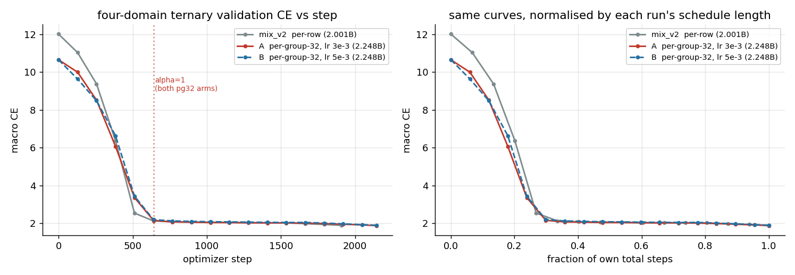
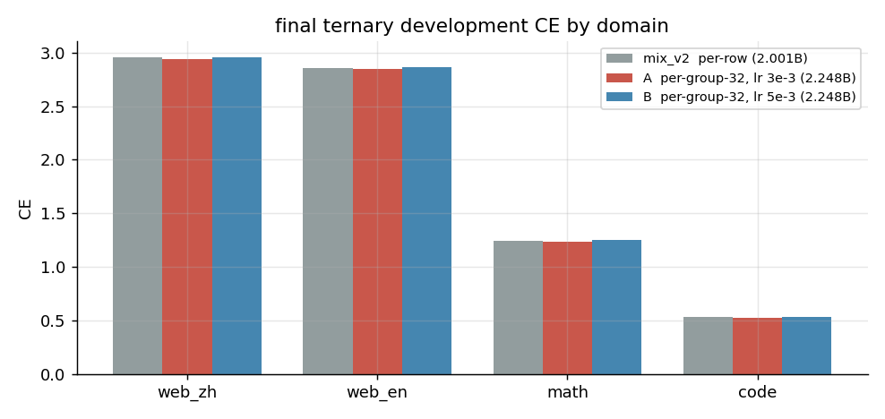
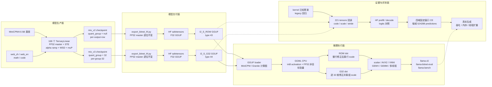
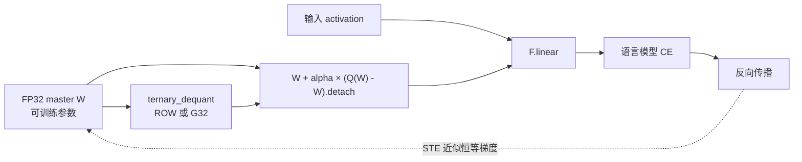

# mix_v3：移植 BitCPM4 配方（per-group-32 + 阶段二 LR）

日期：2026-11-18。本文所有数字来自 `runs/mix_v3_bitcpm_*/metrics.jsonl` 与本地 BitCPM4 权重实测；官方配方引自 MiniCPM4 技术报告（arXiv 2506.07900）§3.3。

## 0. 为什么要做这一轮

前几轮（mix_v1/mix_v2 预训练 + 四轮 SFT）全部使用 **per-row absmean** 量化器。本轮目标是把量化方案对齐面壁 BitCPM4 的做法。过程中先逆推了官方权重，再对照官方论文，发现两处差异，其中只有一处能被 2.5 小时预算验证。

## 1. 官方配方（报告 §3.3 原文要点）

| 要点 | 报告原文 |
|---|---|
| 量化对象 | "we apply ternary quantization to **model weights rather than activations**"（只量化权重，量化激活只是增加开销） |
| 两阶段 | 用预训练高精度 checkpoint 初始化 QAT，大幅降低所需 token |
| LR 日程 | WSD 全程；warmup+stable 占 80%，decay 占 20% |
| 阶段一 LR | **1e-2**（FP8 预训练阶段） |
| 阶段二 LR | **5e-3**（QAT 阶段），且"re-warmup of the learning rate at the beginning of the second stage is **critical**" |
| QAT token 占比 | 需 **> 40%** 总 token（≈2× decay 段 token）才接近从零 QAT 的效果 |
| 总 QAT token | **350B** |
| 优化器 | µP LR 策略 |
| 量化公式 | **报告未给出**（只说明按权重量化） |

## 2. 从权重逆推量化粒度

报告省掉了公式，所以直接对 `BitCPM4-0.5B-verified-Gf7CzOLq/model.safetensors`（218 张量）做逆向。

**（a）粒度：per-group-32。** 把每个二维权重按输入维切成连续块，检查"每块内非零元素是否只有一个绝对值"：

| group | 违反"每组一个幅值"的比例 |
|---:|---:|
| 16 | 0.018% |
| **32** | **0.020%** |
| 64 | 98.84% |
| 128 | 100.00% |

16 和 32 都成立，64 立刻崩掉 → 真实粒度是 **32**（16 是 32 的约数，所以也自洽）。

**（b）scale 统计量：absmean，不是 absmax。** 对原始 MiniCPM4 权重分别套两种规则，比较零占比：

| 规则（group=32） | 零占比 |
|---|---:|
| absmean | 31.45% |
| absmax | 76.51% |
| **BitCPM4 实测** | **34.95%** |

absmean 明显吻合，absmax 差得远。

> **一处自我纠正**：最初我用"absmax 能复现 BitCPM4 权重"作为证据，这是**空洞的**——任何已是三值形态的张量，其每组 amax 恰好等于它自己的 scale，所以 absmax 必然"自洽"。真正的判据只能是零占比，结论不变但依据换了。

**（c）范围**：168 个投影（24 层 × 7）为三值，`embed_tokens` / `norm` 保持 bf16 浮点。存储形式是**反量化后的三值**（`0, ±s`），因此 HF 原生推理即可复现，无需自定义 kernel。

## 3. 我们的实现改动

`qat/quant.py` 新增粒度开关：

- `GROUP_SIZE = 32`，模块级 `_quant_group`，`set_quant_group(int | None)`
- `ternary_quantize` / `ternary_dequant` 支持两种模式：int → per-group（codes `[rows, groups, group_size]`、scale `[rows, groups, 1]`）；`None` → 旧 per-row（codes `[rows, cols]`、scale `[rows, 1]`）
- 输入维不是 32 整数倍时按尾部 padding，并用 mask 把 padding 排除在均值外

**兼容性（关键）**：老 run 的 `config.json` 里没有 `quant_group` 键。`load_config` 显式把缺失的键读成 `None`（per-row），而不是继承新默认值 32；`eval_downstream.py` 和 `train_alpaca_sft.py` 都通过 `quant_group_of(ckpt)` 从 checkpoint 所属 run 的配置里读回粒度。已验证：`runs/mix_v2_qat_sft/snapshots/epoch_4/model.pt` 读回 `None`。**历史结果不受影响。**

开销：per-group-32 每次量化 4096×4096 权重耗时 0.384 ms，per-row 为 0.297 ms，差值可忽略。

单元验证：per-group-32 重建相对误差 0.4981，per-row 0.5070（分组更细，误差更小，符合预期）。回归测试 58 passed。

## 4. 实验设计

### 4.1 为什么拆成两臂

总预算 4.5B token（用户选定，约 2.5 小时）。若单臂跑 4.5B 只能得到一个终点数字，无法归因。拆成两臂各 2.248B（2144 更新）：

| 臂 | 量化粒度 | LR | warmup | 相对参照 |
|---|---|---:|---:|---|
| A `mix_v3_bitcpm_pg32` | per-group-32 | 3e-3 | 2% | 对比 mix_v2，**只改粒度** |
| B `mix_v3_bitcpm_pg32_lr5e3` | per-group-32 | **5e-3** | **5%** | 对比 A，**再叠加官方阶段二 LR** |

墙钟仍约 2.5 小时（两臂并行，各 4 卡），总训练量正好 4.5B。参照点：mix_v2 QAT（per-row）在 2.001B token 达到四域三值开发 CE **1.897**。

### 4.2 数据约束（必须说明）

`data/mix_v2` 池仅 **4.46B**（web_zh 1.84B / web_en 1.92B / math 350M / code 350M）。70/15/15 配比下：

| 域 | 单臂需要 | 池子 | passes |
|---|---:|---:|---:|
| web_zh | 0.787B | 1.840B | 0.428 |
| web_en | 0.787B | 1.920B | 0.410 |
| math | 0.337B | 0.350B | 0.963 |
| code | 0.337B | 0.350B | 0.963 |

全部 **≤ 1 pass**，无重复。这是选 2.248B/臂 的直接原因：4.5B 单臂会让 math/code 各需 1.93 遍。

### 4.3 无法在本轮验证的部分

官方 **350B** token（是我们的 175 倍）与 **QAT 占比 >40%** 的日程，在 4.46B 数据池上无法复现——那不是 token 预算问题，而是数据总量问题。本轮只验证**方法**（粒度 + LR 配方），不宣称复现官方效果。官方 0.5B 模型 MMLU 49.88 / CMMLU 55.88 / GSM8K 25.55，是在完整预训练语料上跑 350B QAT 得到的，不可直接对标。

## 5. 训练过程与结果

两臂各 2144 步 / 2.248B token，同时启动（GPU 0-3 与 4-7），实际耗时约 2.3 小时，均 exit=0。

### 5.1 量化适应期的曲线



三值验证 CE（四域等权平均，同一步 = 同一批 token）：

| step | tokens | alpha | v2 per-row | A pg32 lr3e-3 | B pg32 lr5e-3 |
|---:|---:|---:|---:|---:|---:|
| 0 | 0M | 0.00 | 12.003 | 10.645 | 10.645 |
| 128 | 134M | 0.20 | 11.029 | 9.991 | 9.629 |
| 256 | 268M | 0.40 | 9.372 | 8.515 | 8.482 |
| 384 | 402M | 0.60 | 6.373 | 6.071 | 6.634 |
| 512 | 536M | 0.80 | 2.544 | 3.363 | 3.441 |
| 640 | 671M | **1.00** | 2.131 | 2.161 | 2.197 |
| 768 | 805M | 1.00 | 2.083 | 2.077 | 2.131 |
| 1024 | 1074M | 1.00 | 2.058 | 2.045 | 2.088 |
| 1280 | 1342M | 1.00 | 2.041 | 2.030 | 2.066 |
| 1536 | 1611M | 1.00 | 2.027 | 2.025 | 2.048 |
| 1908 | 2001M | 1.00 | **1.897** | — | — |
| 2144 | 2248M | 1.00 | — | **1.885** | **1.900** |

**读法**：三阶段。step 0–640 是 alpha ramp，CE 从 ~10.6 塌到 ~2.2（量化适应期）；640–1715 是恒定 LR 平台期，缓降；1715 之后 LR 线性衰减，再降一截。最终值必须在衰减结束后取，中途的数字不可比。

### 5.2 关键：两个不同长度的 run 怎么比

v2 是 1908 步、A/B 是 2144 步，**直接比终点是不公平的**——A/B 多跑了 12% 且更晚进入 LR 衰减。两个正确的切法：

**（a）日程归一化**（各自 total_steps 归一化，第 2 张子图）：

| 日程进度 | v2 | A | B | A−v2 | B−A |
|---:|---:|---:|---:|---:|---:|
| 0.3 | 2.544 | 2.161 | 2.197 | −0.383 | +0.036 |
| 0.5 | 2.074 | 2.045 | 2.088 | −0.029 | +0.043 |
| 0.7 | 2.041 | 2.025 | 2.048 | −0.016 | +0.024 |
| 0.9 | 1.987 | 1.956 | 1.977 | −0.031 | +0.021 |
| 1.0 | 1.897 | 1.885 | 1.900 | −0.013 | +0.016 |

**（b）恒定 LR 平台期的等步对比**（两者 alpha 均为 1、LR 均未衰减）：

| step | v2 | A | A−v2 |
|---:|---:|---:|---:|
| 768 | 2.0828 | 2.0768 | −0.006 |
| 896 | 2.0742 | 2.0626 | −0.012 |
| 1024 | 2.0578 | 2.0451 | −0.013 |
| 1152 | 2.0465 | 2.0438 | −0.003 |
| 1280 | 2.0405 | 2.0298 | −0.011 |
| 1408 | 2.0366 | 2.0237 | −0.013 |
| 1536 | 2.0269 | 2.0246 | −0.002 |

两种切法给出**同一个方向、同一个量级**的结论。

### 5.3 各域终值



| 域 | v2 per-row | A pg32 | B pg32 5e-3 |
|---|---:|---:|---:|
| web_zh | 2.955 | 2.937 | 2.956 |
| web_en | 2.859 | 2.846 | 2.866 |
| math | 1.244 | 1.233 | 1.248 |
| code | 0.532 | 0.524 | 0.531 |
| **四域均值** | **1.897** | **1.885** | **1.900** |

A 在**四个域上全部**略优（−0.008 到 −0.018），不是靠某一域拉平均。

### 5.4 下游评测（基础模型，未 SFT）

评测协议与 mix_v2 完全一致（5-shot MC，8-shot GSM8K，max_new=1024，同一评测脚本），两臂均以三值前向（`alpha=1`）评测，粒度由 checkpoint 所属 run 的配置读回为 per-group-32。

| 指标 | v2 per-row (2.001B) | A pg32 3e-3 (2.248B) | B pg32 5e-3 (2.248B) |
|---|---:|---:|---:|
| MMLU | 24.29% | **25.54%** | 25.65% |
| CMMLU | 25.04% | 25.13% | 24.48% |
| C-Eval | 24.96% | 25.19% | 23.70% |
| GSM8K acc | 2.27% | 3.26% | 2.27% |

差值检验（二项标准误，`se = sqrt(0.25·0.75/n)`）：

| 指标 | n | A − v2 | se | z |
|---|---:|---:|---:|---:|
| MMLU | 14,042 | **+1.25pp** | 0.37 | **+3.43** |
| CMMLU | 11,582 | +0.09pp | 0.40 | +0.24 |
| C-Eval | 1,346 | +0.22pp | 1.18 | +0.19 |

| 指标 | n | B − A | se | z |
|---|---:|---:|---:|---:|
| MMLU | 14,042 | +0.11pp | 0.37 | +0.29 |
| CMMLU | 11,582 | −0.66pp | 0.40 | −1.63 |
| C-Eval | 1,346 | −1.49pp | 1.18 | −1.26 |

**GSM8K 这一列不可解读。** 两臂与 v2 的 `length_stop_count` 都是 1318–1319/1319，即几乎所有题都顶到 1024 token 上限——未做 SFT 的基础模型不会停止生成，acc 只反映碰对概率（见 mix_v2 记录 §2.3）。这里列出仅为完整性，不参与任何结论。

### 5.5 下游说明了什么

1. **MMLU +1.25pp（z=3.43）是本轮唯一统计显著的改进**，方向与验证 CE 一致。但要注意它同时混入了两个变化：粒度换成 per-group-32 **且** 多训了 12% token，本轮无法把二者分开（把 A 臂截到 1908 步本可以分开，但训练时未保存中途快照，事后无法补做）。
2. **CMMLU / C-Eval 的差异都在噪声内**（|z| < 1.3），不能说粒度改善了中文选择题。
3. **B 臂在 CMMLU / C-Eval 上更差**（虽未达显著），与验证 CE 的方向一致，进一步支持"5e-3 偏激进"。

## 6. 结论

### 6.1 已确认

1. **per-group-32 略优于 per-row，但幅度很小**。同日程进度下 CE 低 **0.013–0.031**；恒定 LR 平台期低 **0.002–0.013**。四个域方向一致。这是真实但边际的改善——**粒度不是这个项目的主要瓶颈**。
2. **官方阶段二 LR（5e-3）在这个预算下反而更差**。B 全程高于 A（+0.016 到 +0.043），终值 1.900 vs 1.885。B 的 grad_norm 也系统性更高（同期 1.06 vs 0.68），说明 5e-3 对三值路径偏激进。
3. 三条曲线在图上几乎重合 —— 强化了 (1)(2)：**这两个改动都不是数量级的影响**。
4. **下游只有 MMLU 显著改善（+1.25pp，z=3.43）**，CMMLU / C-Eval 都在噪声内。且该改善**同时混入了"多训 12% token"**，未能在本轮分离。
5. 验证 CE 与下游方向一致（A 最好、B 最差），但这个一致性建立在很小的 CE 差异上，不宜过度解读。

### 6.2 必须说明的限制

- **官方 LR 配方的结论不能外推**。报告说的 5e-3 配合「QAT 占总 token >40%」以及阶段一的 1e-2，是一个**完整两阶段日程**里的一环。我们只截取了第二阶段的 LR 值，没有配套的阶段一 FP8 预训练和 token 配比，因此本轮的 B 臂**不是对官方配方的检验**，只说明「在我们的 2.248B 单阶段设定里，5e-3 比 3e-3 差」。
- **token 量差 175 倍**。官方 350B，我们 2.248B。官方 0.5B 模型 MMLU 49.88 / CMMLU 55.88 / GSM8K 25.55 是在完整预训练语料上得到的，**不可与本轮数字对标**。
- **数据池上限**。单臂 2.248B 是 `data/mix_v2`（4.46B）在 70/15/15 下能做到「≤1 pass」的最大值；再长就必须重复 math/code。
- 本轮**没有也不能**验证量化公式本身与 BitCPM4 完全等价：报告未给公式，粒度是我们从权重逆推的，scale 规则（absmean）是用零占比间接判定的。

### 6.3 下一步建议

粒度与 LR 都不是大杠杆，继续在这两项上调参的回报有限。真正的差距在**数据总量**（4.46B vs 官方的量级）。若要继续，优先级应是：扩充预训练语料 > 重调 QAT 超参。

## 7. MiniCPM4-0.5B 三值模型 bitnet.cpp 部署与推理验证

本节日期：2026-11-19。以下完整记录本地私有 fork 的部署改动、真实推理、逐域 CE、性能与内存结果；独立版见 `BITNET_CPP_DEPLOYMENT.md`，本节不改动前面的训练实验结论。

### 7.1 结果概览

已在 Microsoft bitnet.cpp 的 vendored llama.cpp/GGML 中实现两种新格式，并完成真实 x86 CPU 推理：

| checkpoint / 部署格式 | 原生 HF 四域 macro CE | llama.cpp 四域 macro CE | 差值 | GGUF 文件 |
|---|---:|---:|---:|---:|
| `mix_v2_qat_70_15_15` / `I2_S_ROW` | 1.897251 | **1.899053** | +0.001801 | 694,336,128 B（662.171 MiB） |
| `mix_v3_bitcpm_pg32` / `I2_S_G32` | 1.884792 | **1.886447** | +0.001655 | 738,056,832 B（703.866 MiB） |

两种模型均完成：168 个投影的量化与 GGUF 回读、prefill、cached decode、真实 greedy 生成，以及四域各 256 个固定 2048-token 窗口的 CE。每域有效 next-token 预测数均为 **524,288**，八组任务均 exit=0。

**结论：两种部署都保持了原 checkpoint 的量化粒度和精度，没有重训，也没有把一种粒度转换成另一种。** G32 与 ROW 来自不同训练 run，二者的模型质量差异不能解释成“仅更换存储格式”的因果效果。

### 7.2 为什么不能直接复用旧 I2_S

旧版活跃的 `I2_S` 是**整张量一个 scale**，而两个 checkpoint 分别是：

- ROW：每个输出通道、即每个权重输出行一个 absmean scale；
- G32：每行每连续 32 个输入权重一个 absmean scale。

此前实测把 G32 checkpoint 强行放进旧 per-tensor 路径后，四域 macro CE 从 **1.8848** 变为 **3.4265**。因此这里不是简单修改打包代码，而是需要新的静态 GGML 类型、GGUF 物理布局及对应计算 kernel。

两个 checkpoint 保存的是 FP32 master，而不是已经三值化的部署权重。转换必须走：

```text
FP32 master state.pt
  → 逐位不变的 FP32 HF safetensors 中间目录
  → F32 GGUF
  → 按 checkpoint 原生粒度量化成 I2_S_ROW 或 I2_S_G32
```

不能先保存反量化三值 `0, ±s` 再重算 absmean；那样会把 scale 错算成 `s × nonzero_density`。导出器同时校验 run 配置和全部 168 个完整投影名称，禁止 ROW/G32 交叉导出。

### 7.3 新格式与计算语义

#### 7.3.1 权重量化

对一个量化区域 `g`：

```text
s_g = max(mean_{j in g}(|W_j|), 1e-8)
q_j = clamp(round(W_j / s_g), -1, 1)
stored_code_j = q_j + 1             # 0/1/2
W_deploy_j = q_j × s_g
```

每个 2-bit code 按字节内高位到低位打包。物理布局如下：

| 格式 | GGML type | scale 数量 | 每行字节数 | 约束 |
|---|---:|---:|---:|---|
| `I2_S_ROW` | 43 | 每行 1 个 FP32 | `K/4 + 4` | K 为 32 的倍数 |
| `I2_S_G32` | 44 | 每行 `K/32` 个 FP32 | `K/4 + 4×K/32` | K 为 32 的倍数 |

两种格式均不使用旧 `I2_S` 的 32-byte trailer。GGML sizing、stride、GGUF offset、loader 和 kernel 使用同一物理行大小。旧 `I2_S` 枚举、布局和执行路径未改。

#### 7.3.2 激活与点积

activation 仍量化为 int8。对 32 维块，整数计算为：

```text
integer_dot_g = Σ(code_i × q8_i) − Σ(q8_i)
```

- ROW：整行累加整数贡献，最后乘一个行 scale，再除以 activation scale；
- G32：每组分别计算 activation correction，乘该组 scale，按原组序累加，最后除以 activation scale。

因此新增的是**权重量化粒度**，不是把训练改成 activation 三值，也不是声称端侧结果只含 weight-roundtrip 误差。

#### 7.3.3 x86 kernel

实现了：GEMV、GEMM、行/列尾部、真实多线程二维路径、量化 `get_rows`、标量回退、AVX2 和 VNNI。

- AVX-VNNI/AVX512-VNNI 使用 `_mm256_dpbusd_epi32`；
- AVX2 回退使用 `_mm256_maddubs_epi16` + `_mm256_madd_epi16`；
- code 作为 unsigned 0/1/2，activation 作为 signed int8；
- SIMD 只改变指令实现，不改变整数点积语义。

主要改动文件：

| 文件 | 内容 |
|---|---|
| `ggml/include/ggml.h`、`ggml/src/ggml.c` | 类型枚举、traits、物理大小、量化/反量化分发 |
| `ggml/src/gguf.cpp`、`gguf-py/gguf/*` | GGUF 类型、文件大小和 Python reader/writer |
| `ggml/src/ggml-cpu/quants.c` | 打包、反量化、ROW/G32 dot、AVX2/VNNI |
| `ggml/src/ggml-cpu/ggml-cpu.c` | int8 workspace、多线程 mul_mat 分发 |
| `ggml/src/ggml-cpu/ggml-cpu-i2s.c` | 二维 GEMM/GEMV 与尾部 |
| `ggml/src/ggml-cpu/ops.cpp` | 量化权重 get_rows |
| `src/llama-quant.cpp`、`tools/quantize/quantize.cpp` | 量化范围、回退和 CLI 类型 |
| `tests/test-i2s-scaled.cpp` | 新格式已知答案及 legacy 回归 |
| `tools/bitnet-eval/bitnet-eval.cpp` | 原始 token 的 prefill/decode/logits/CE 工具 |

MiniCPM 图继续复用 fork 现有 Granite 路径，保留 Q/K permutation、embedding/residual/logit scaling 和 long/short RoPE factors。HF 的 `hidden_states / 4` 与 GGUF `logit_scale=4`、图中 `1/f_logit_scale` 已核对，不另造一套模型架构。

### 7.4 模型产物

| 产物 | 字节数 | 说明 |
|---|---:|---|
| 任一 F32 GGUF | 2,038,028,928 | 1943.616 MiB，转换中间产物 |
| `mix_v2_qat_70_15_15-I2_S_ROW.gguf` | **694,336,128** | 662.171 MiB；llama-quantize payload 660.56 MiB，10.88 BPW |
| `mix_v3_bitcpm_pg32-I2_S_G32.gguf` | **738,056,832** | 703.866 MiB；llama-quantize payload 702.25 MiB，11.57 BPW |

每个量化 GGUF 均有 **221 tensors = 168 个新类型投影 + 53 个 F32 张量**。219 个 HF 权重之外的两个张量是转换生成的 long/short RoPE factors。embedding、lm_head/output、norm 和 RoPE factors 保留 F32，因此整模型有效 BPW 明显高于投影本身的 2-bit 编码，不能直接把 10.88/11.57 BPW 当成三值投影的存储位宽。

ROW/G32 文件分别为 F32 文件的 **34.069% / 36.214%**。G32 多出的 43,720,704 B 主要来自每 32 权重一个 FP32 scale。

### 7.5 分层验证结果

#### 7.5.1 Kernel 已知答案与 legacy 回归

最终 SIMD 二进制重新运行 `test-i2s-scaled`，覆盖 K={32,64,128,256}、rows={1,3,5}、5 个 activation 列、零激活、scale、打包字节序、反量化、GEMV/GEMM 尾部、物理 stride、`ggml_nbytes`，以及真实三线程 GGML mul_mat。

实际结尾：

```text
ok: GGML CPU mul_mat i2_s K=128 rows=5 cols=4 threads=3
ok: GGML CPU mul_mat i2_s_row K=128 rows=5 cols=5 threads=3
ok: GGML CPU mul_mat i2_s_g32 K=128 rows=5 cols=5 threads=3
all scaled I2_S known-answer tests passed
```

旧 `I2_S` 的独立打包、反量化和真实 GGML 图回归也通过。完整输出保存为 `bitnet_cpp/test_i2s_scaled.log`。

#### 7.5.2 GGUF 逐权重回读

验证器对全部 221 个张量检查 shape、类型、物理字节数、Q/K permutation、三值 code、scale 和 F32 精确值：

| 指标 | ROW | G32 |
|---|---:|---:|
| 量化 / 精确 F32 张量 | 168 / 53 | 168 / 53 |
| 非边界 code mismatch | **0** | **0** |
| FP32 half-threshold code 差异 | 205 | 29 |
| 最大边界归一化偏差 | 9.5367e-7 | 8.9407e-8 |
| 最大 scale 绝对误差 | 2.0117e-7 | 8.9407e-8 |
| 最大 scale 相对误差 | 4.6271e-6 | 5.3194e-7 |
| code 相同时最大权重误差 | 2.0117e-7 | 8.9407e-8 |

这些结果**不能描述为逐位完全相同的三值 code**。准确结论是：非半阈值位置完全一致；所有边界翻转均已计数，最大归一化边界距离不超过 9.54e-7，来源于 C++ 与 PyTorch FP32 reduction-order 差异。

包含边界翻转时，ROW/G32 最大单权重差分别为 0.0713753 / 0.0668058；这是一档三值 code 翻转造成的幅值，不应与“同 code 的 scale 误差”混为一谈。

#### 7.5.3 HF 与 llama.cpp logits：prefill 和 cached decode

协议：web_zh 原始 token，32-token prefill + 8 个 cached decode 位置，vocab=73,448；HF 使用 FP32 master、168 个 TernaryLinear、alpha=1、CUDA BF16 autocast。native 使用 int8 activation。

| 指标（40 位置总体） | ROW | G32 |
|---|---:|---:|
| max absolute logit error | 1.295019 | 1.681273 |
| mean absolute logit error | 0.101823 | 0.087666 |
| RMSE | 0.135220 | 0.124521 |
| argmax agreement | 95.0% | 97.5% |
| native CE | 4.573949 | 4.564454 |
| HF CE | 4.566381 | 4.531025 |
| prefill argmax agreement | 93.75% | 100% |
| cached-decode argmax agreement | 100% | 87.5% |

短序列 cached-decode native/HF CE：ROW **2.228561 / 2.204185**，G32 **2.649003 / 2.680007**。

最大的单个 logit 误差必须结合 int8 activation、HF BF16 autocast 和浮点累加顺序理解，不能当成纯权重回读误差；权重回读误差已在 §7.5.2 单独报告。40 个位置只用于执行路径对齐，不用于评价整体模型质量。

#### 7.5.4 一个完整 2048-token 窗口的 HF 对照

域为 web_zh、window=0，CE 使用 2048 个 shifted targets：

| 模型 | HF CE | llama.cpp CE | 差值 |
|---|---:|---:|---:|
| ROW | 3.570723 | 3.573723 | +0.003000 |
| G32 | 3.541007 | 3.540195 | −0.000812 |

这一步排除了“只有 32-token 短序列能对齐”的假象，也为后面的完整四域评测提供了直接依据。

### 7.6 完整固定窗口 CE

#### 7.6.1 协议

- 每个模型分别在 web_zh、web_en、math、code 上运行；
- 每域取原始 uint32 token stream 的前 256 个互不重叠窗口；
- 每窗读取 2049 token：2048 inputs + 1 个 shifted target；
- 每窗重置 KV memory，所有 prefill 位置请求 logits；
- 不重新 tokenize，不混入 cached decode；
- 每域 524,288 predictions，与原生 HF evaluation 使用同一批窗口。

#### 7.6.2 逐域真实结果

| 模型 | 域 | 原生 HF CE | llama.cpp CE | llama − HF | llama top-1 |
|---|---|---:|---:|---:|---:|
| ROW | web_zh | 2.954505 | **2.956743** | +0.002238 | 46.0934% |
| ROW | web_en | 2.858753 | **2.860963** | +0.002210 | 44.0302% |
| ROW | math | 1.243507 | **1.245192** | +0.001685 | 71.3264% |
| ROW | code | 0.532241 | **0.533313** | +0.001072 | 86.0779% |
| **ROW** | **四域 macro** | **1.897251** | **1.899053** | **+0.001801** | — |
| G32 | web_zh | 2.937009 | **2.939107** | +0.002098 | 46.2677% |
| G32 | web_en | 2.845672 | **2.847640** | +0.001968 | 44.1811% |
| G32 | math | 1.232789 | **1.234289** | +0.001500 | 71.4926% |
| G32 | code | 0.523697 | **0.524752** | +0.001055 | 86.2673% |
| **G32** | **四域 macro** | **1.884792** | **1.886447** | **+0.001655** | — |

逐任务 JSON 还校验了 `windows=256`、`sequence_length=2048`、`decode_steps=0`、`token_predictions=524288` 和有限 CE/top-1。汇总见 `bitnet_cpp/ce_summary.json`。

#### 7.6.3 结论

1. 两种格式在四域上都只有 **0.001055–0.002238** 的 CE 偏差，macro 偏差分别为 **+0.001801 / +0.001655**，没有出现旧 per-tensor 路径那种粒度错误。
2. 八组差值均为小幅正值，符合 native int8 activation、HF BF16 autocast 和不同浮点累加实现共同造成的微小系统差异；不能把该差值全部归因于三值权重。
3. llama.cpp 下 G32 macro 比 ROW 低 **0.012606**，原生 HF 下低 **0.012460**；部署基本保留了两个 checkpoint 原有的相对差异。
4. 八组 CE 是 8×24 线程并发运行的，耗时包含 CPU/内存带宽争用，**不作为性能结果**；性能只看隔离基准。

### 7.7 隔离性能测试

#### 7.7.1 标准 llama-bench

环境：Intel Xeon Platinum 8480+，CPU backend，`n_gpu_layers=0`。两个模型顺序执行，不与 CE 或其他推理并发。参数为 `p=512`、`n=128`、`threads=16,64`、`repetitions=3`、`n_batch=2048`、`n_ubatch=512`，保留工具默认 warmup 和 mmap。

| 模型 | 线程 | 512-token prefill，tok/s | 128-token decode，tok/s |
|---|---:|---:|---:|
| ROW | 16 | 169.316 ± 25.492 | 101.230 ± 9.267 |
| ROW | 64 | **525.705 ± 43.981** | **133.395 ± 5.854** |
| G32 | 16 | 190.826 ± 33.683 | 91.686 ± 2.863 |
| G32 | 64 | 483.244 ± 16.051 | 128.685 ± 2.036 |

表中为 3 次均值 ± llama-bench 报告的 stddev，原始每次样本保存在 `bench_row.json` / `bench_g32.json`。prefill 波动较大，尤其第一次样本偏慢，因此不能只挑最快一次作为结果。

整个 benchmark 进程峰值 RSS：ROW **751,992 KiB（734.4 MiB）**，G32 **794,640 KiB（776.0 MiB）**。这是覆盖两种线程配置的套件级峰值；真实 CLI、固定 `c=512` 的内存见 §7.8。

结论：

1. 16→64 线程，ROW/G32 prefill 分别提升 **3.10× / 2.53×**，decode 只提升 **1.32× / 1.40×**。decode 不随线程线性扩展，已受到内存带宽和线程同步限制。
2. 16 线程时 G32 prefill 较快，64 线程时 ROW 较快；decode 则 ROW 在 16/64 线程分别高 **10.4% / 3.7%**。因此不能笼统宣称“G32 一定更快”，应按线程数和工作负载选择。
3. G32 文件比 ROW 大约 **6.30%**，并增加每组 scale 读取与修正；其优势是保持对应 checkpoint 的精度粒度，不是无条件吞吐优势。
4. 本结果只代表该 Xeon 服务器，不能外推到手机、ARM、Metal 或 CUDA。

#### 7.7.2 完整 2048-token prefill 的 SIMD 前后对照

使用同一个 web_zh window=0、`n_batch=n_ubatch=2048`，此前还保留了一组开发和优化过程中的直接对照：

| 模型 / 实现 | 线程 | 总耗时 | prefill 耗时 | CE |
|---|---:|---:|---:|---:|
| ROW scalar | 16 | 46.756 s | 46.689 s | 3.573722934 |
| ROW scalar | 64 | 19.185 s | 19.165 s | 3.573722934 |
| ROW SIMD | 64 | **8.152 s** | **8.122 s** | 3.573722934 |
| G32 SIMD | 64 | **6.734 s** | **6.709 s** | 3.540194581 |

同样 64 线程下，ROW 从 scalar 到 SIMD 加速 **2.35×**，CE 完全不变。该表是单次长窗口测量，和 §7.7.1 的 512-token、3 次标准基准互补；注意力长度和测量协议不同，不能直接比较两组 tok/s。

此外，优化前后两份 40×73,448 FP32 logits 文件均逐字节一致：SHA256 分别为 `dd13f809…9589`（ROW）和 `f36b3805…dd7a`（G32）。这证明 SIMD 没有改变这些固定输入的数值输出。

### 7.8 真实 greedy 生成与内存

统一命令：prompt=`The capital of France is`，`n=24`、`t=tb=16`、`c=512`、`temp=0`、`top-k=1`、`--no-warmup --single-turn`。下表直接对比优化前后相同 CLI 路径：

| 模型 | 指标 | scalar | 最终 SIMD | 变化 |
|---|---|---:|---:|---:|
| ROW | prompt | 31.3 t/s | 123.2 t/s | 3.94× |
| ROW | generation | 24.7 t/s | **62.7 t/s** | **2.54×** |
| ROW | wall，包括加载 | 7.805 s | 6.567 s | 1.19× |
| ROW | peak RSS | 717,124 KiB | **716,224 KiB（699.4 MiB）** | 基本不变 |
| G32 | prompt | 27.7 t/s | 108.3 t/s | 3.91× |
| G32 | generation | 23.5 t/s | **51.8 t/s** | **2.20×** |
| G32 | wall，包括加载 | 8.151 s | 6.602 s | 1.23× |
| G32 | peak RSS | 759,680 KiB | **759,096 KiB（741.3 MiB）** | 基本不变 |

两次 greedy 文本保持一致：

- ROW：`The capital of France is Brunswick, which is located in the province of Brunswick. Brunswick is a small town in the province`
- G32：输出以 `The capital of Germany is(["Auflauter"] ...` 开始，完整内容见日志。

这些是**未 SFT 的 base model**，G32 的短样例不是有用回答；生成质量不作为 kernel 正确性的唯一判据，精度判断使用 §7.5–7.6 的权重、logits 和固定窗口 CE。

24-token CLI 的 generation 数字低于 128-token llama-bench 稳态结果，主要因为短测量的首尾开销占比更高。wall time 还包含模型加载，所以 wall 加速比不能代替 decode kernel 加速比。完整输出、命令和 wrapper 统计保存在 `generate_*_scalar.log` / `generate_*_simd.log`。

### 7.9 复现命令

以下变量对应本次实际路径：

```bash
ROOT=/chubao/tj-train-ssd-21/liudan190
QAT=$ROOT/QAT_minicpm
BN=$ROOT/bitnet.cpp
LL=$BN/3rdparty/llama.cpp
OUT=$QAT/reports/pretrain_v2/mix_v3_bitcpm/bitnet_cpp
```

构建和已知答案：

```bash
cmake --build "$BN/build" --target llama-cli llama-quantize \
  llama-bitnet-eval llama-bench test-i2s-scaled -j 8
"$BN/build/bin/test-i2s-scaled"
```

FP32 master 导出（输出目录必须不存在，工具拒绝覆盖）：

```bash
python3 "$QAT/tools/export_bitnet_hf.py" \
  --checkpoint "$QAT/runs/mix_v2_qat_70_15_15/checkpoints/final/state.pt" \
  --run-config "$QAT/runs/mix_v2_qat_70_15_15/resolved_config.json" \
  --base-model "$QAT/MiniCPM4-0.5B-fjzcuwlf" \
  --output-dir "$QAT/exports/mix_v2_qat_70_15_15_fp32_master" \
  --granularity row

python3 "$QAT/tools/export_bitnet_hf.py" \
  --checkpoint "$QAT/runs/mix_v3_bitcpm_pg32/checkpoints/final/state.pt" \
  --run-config "$QAT/runs/mix_v3_bitcpm_pg32/resolved_config.json" \
  --base-model "$QAT/MiniCPM4-0.5B-fjzcuwlf" \
  --output-dir "$QAT/exports/mix_v3_bitcpm_pg32_fp32_master" \
  --granularity g32
```

F32 GGUF 与目标格式（另一个模型按同样参数替换路径和类型）：

```bash
python3 "$LL/convert_hf_to_gguf.py" \
  "$QAT/exports/mix_v2_qat_70_15_15_fp32_master" \
  --outfile "$QAT/gguf/mix_v2_qat_70_15_15-F32.gguf" --outtype f32
"$BN/build/bin/llama-quantize" \
  "$QAT/gguf/mix_v2_qat_70_15_15-F32.gguf" \
  "$QAT/gguf/mix_v2_qat_70_15_15-I2_S_ROW.gguf" I2_S_ROW 16

python3 "$LL/convert_hf_to_gguf.py" \
  "$QAT/exports/mix_v3_bitcpm_pg32_fp32_master" \
  --outfile "$QAT/gguf/mix_v3_bitcpm_pg32-F32.gguf" --outtype f32
"$BN/build/bin/llama-quantize" \
  "$QAT/gguf/mix_v3_bitcpm_pg32-F32.gguf" \
  "$QAT/gguf/mix_v3_bitcpm_pg32-I2_S_G32.gguf" I2_S_G32 16
```

GGUF 回读验证（G32 替换三个对应路径和 `--granularity g32`）：

```bash
python3 "$QAT/tools/verify_bitnet_gguf.py" \
  --gguf "$QAT/gguf/mix_v2_qat_70_15_15-I2_S_ROW.gguf" \
  --hf-dir "$QAT/exports/mix_v2_qat_70_15_15_fp32_master" \
  --granularity row --llama-dir "$LL" --qat-root "$QAT" \
  --output "$OUT/mix_v2_row_roundtrip.json"
```

完整 CE 单域命令；其余七组只替换模型、token 域和输出前缀，协议不变：

```bash
OMP_NUM_THREADS=24 "$BN/build/bin/llama-bitnet-eval" \
  --model "$QAT/gguf/mix_v2_qat_70_15_15-I2_S_ROW.gguf" \
  --tokens "$QAT/data/mix_v2/web_zh_val.bin" \
  --seq-len 2048 --windows 256 --threads 24 --threads-batch 24 \
  --metrics-out "$OUT/row_web_zh_ce.json"
```

统一性能基准：

```bash
"$BN/build/bin/llama-bench" \
  -m "$QAT/gguf/mix_v2_qat_70_15_15-I2_S_ROW.gguf" \
  -p 512 -n 128 -t 16,64 -r 3 -ngl 0 -o json
```

真实生成：

```bash
"$BN/build/bin/llama-cli" \
  -m "$QAT/gguf/mix_v2_qat_70_15_15-I2_S_ROW.gguf" \
  -p 'The capital of France is' -n 24 -t 16 -tb 16 -c 512 \
  --temp 0 --top-k 1 --no-warmup --no-display-prompt --single-turn
```

### 7.10 限制与最终结论

- **仅支持并验证 x86 CPU**；未实现或验证 Metal/CUDA/ARM。
- activation 是 int8；HF 对照使用 BF16 autocast，因此端到端差异不是纯 weight-roundtrip 误差。
- 三值 code 在非半阈值位置完全一致，半阈值翻转已如实统计，不宣称全部 code bitwise-identical。
- legacy `I2_S` 已由已知答案和真实 GGML 回归覆盖，但本轮没有重新评测官方 BitNet 模型的完整 CE/性能。
- 结果仅适用于当前 MiniCPM4-0.5B dense GQA 转换路径，不外推到其他架构或官方模型。
- 两种格式都以 FP32 embedding/lm_head 为代价保留现有数值语义；进一步压缩这些 F32 张量不在本轮范围。
- 所有修改只保留在本地私有 fork；未提交、未 push、未创建上游 PR。

**最终结论：两种 checkpoint 均已完成可运行、可复现、数值对齐的 bitnet.cpp x86 部署。ROW/G32 的完整 macro CE 分别只偏移 +0.001801/+0.001655；最终 SIMD 使真实 16 线程短生成达到 62.7/51.8 token/s，稳态 64 线程 decode 达到 133.4/128.7 token/s，峰值内存没有因 SIMD 增加。**

### 7.11 结果文件索引

| 文件（均在本报告目录下） | 内容 |
|---|---|
| `bitnet_cpp/ce_summary.json` | 八组最终 CE、top-1、native 对照及校验后的 macro |
| `bitnet_cpp/{row,g32}_{domain}_ce.json/.log` | 每域完整原始结果与 256 窗日志 |
| `bitnet_cpp/mix_v2_row_roundtrip.json` | ROW 全张量回读结果 |
| `bitnet_cpp/mix_v3_g32_roundtrip.json` | G32 全张量回读结果 |
| `bitnet_cpp/mix_v2_row_logits_comparison.json` | ROW prefill/decode HF logits 对照 |
| `bitnet_cpp/mix_v3_g32_logits_comparison.json` | G32 prefill/decode HF logits 对照 |
| `bitnet_cpp/full_window_hf_check.json` | 完整 2048-token HF 对照 |
| `bitnet_cpp/test_i2s_scaled.log` | 最终 kernel 与 legacy 回归输出 |
| `bitnet_cpp/simd_logits_regression.log` | SIMD 前后 logits SHA256 与 cmp 结果 |
| `bitnet_cpp/benchmark_summary.json` | 吞吐、波动、内存和真实生成加速汇总 |
| `bitnet_cpp/bench_{row,g32}.json/.log` | llama-bench 原始结果 |
| `bitnet_cpp/generate_{row,g32}_{scalar,simd}.log` | 真实生成文本、速度、命令和峰值 RSS |
| `bitnet_cpp/{export,convert,quantize}_*.log` | 导出、F32 转换和量化原始日志 |

## 8. 技术分享与教学架构

本节把前面的实验和部署记录整理成一套可讲解、可演示、可复习的项目架构。它不是另起一套设计，而是对当前真实代码和产物的结构化总结。训练原理的展开讲解可配合[三值 QAT 全流程教学文档](../../QAT_TEACHING_NOTES.md)，具体实验数字仍以本报告为准。

### 8.1 一句话与一条主线

**一句话介绍：本项目完成了 MiniCPM4-0.5B 从三值量化感知训练、两种原生量化粒度 checkpoint，到 bitnet.cpp x86 真实推理和分层数值验证的完整闭环。**

技术分享不要按“改了哪些文件”平铺直叙，而应围绕一条主线展开：

> 如何把训练时定义的 `Q(W)` 原样变成端侧可执行的存储和计算，并用逐层证据证明既没有改变模型语义，也确实获得了可运行的推理性能。

整条链路可以概括为：

```text
数据与基座模型
  → 三值 QAT（FP32 master + STE + alpha ramp）
  → 两种原生 checkpoint（ROW / G32）
  → 无损 HF 中间表示与 F32 GGUF
  → 两种原生 2-bit GGUF（I2_S_ROW / I2_S_G32）
  → GGML CPU 图执行、int8 activation、三值权重整数点积
  → kernel / 权重 / logits / CE / 生成 / 性能六层验证
```

### 8.2 端到端总体架构



这张图的讲解重点是四个面各自只承担一种责任：

| 架构面 | 输入 | 输出 | 必须守住的不变量 |
|---|---|---|---|
| 模型生产面 | 基座模型、四域数据、训练配置 | FP32 master checkpoint | 前向使用目标粒度的 `Q(W)`，反向通过 STE 更新 master |
| 模型交付面 | `state.pt` 与对应 run 配置 | 原生粒度的量化 GGUF | 不提前三值化、不交叉转换、不改变 MiniCPM 图语义 |
| 推理执行面 | GGUF、token、KV cache | logits 与生成 token | packed code、scale、activation correction 和物理 stride 一致 |
| 证据与评测面 | 参考实现、模型产物、固定输入 | 数值、日志和性能结论 | 参考输入一致，逐层定位误差，不用生成样例代替正确性证明 |

### 8.3 两条模型分支：语义相同，粒度不同

两种格式共享三值定义：

```text
s_g = max(mean_{j in g}(|W_j|), 1e-8)
q_j = clamp(round(W_j / s_g), -1, 1)
Q(W)_j = q_j × s_g
stored_code_j = q_j + 1
```

差别只在量化区域 `g` 以及 scale 的存储和归约位置：

| 分支 | 训练配置 | 部署类型 | 每行物理布局 | 归约方式 |
|---|---|---|---|---|
| ROW | `quant_group=null` | `I2_S_ROW=43` | `K/4` bytes codes + 1 个 FP32 scale | 整行整数点积后统一减 `act_sum`，再乘行 scale |
| G32 | `quant_group=32` | `I2_S_G32=44` | `K/4` bytes codes + `K/32` 个 FP32 scales | 每 32 维独立减组内 activation sum、乘组 scale，再按组累加 |

这里必须在分享中明确三件事：

1. **per-channel 在本项目中是 per-output-row**，即每个输出通道对应权重矩阵的一行，不是按输入列。
2. **两种 checkpoint 不是同一模型的两种压缩包**。它们来自不同训练 run，不能把 CE 差异解释成单纯更换格式的因果效果。
3. **legacy `I2_S` 不在这条主链上**。它是整张量一个 scale，保留它只为官方 BitNet 兼容和回归，不能拿来替代 ROW/G32。

训练侧入口是[qat/quant.py](../../../qat/quant.py#L66-L108)，部署侧打包和点积入口是[quants.c](../../../../bitnet.cpp/3rdparty/llama.cpp/ggml/src/ggml-cpu/quants.c#L1388-L1550)。

### 8.4 训练架构：真正被优化的是 FP32 master



教学时把一行代码拆成三层含义：

- **前向**：`W_fwd = (1-alpha)×W + alpha×Q(W)`，`alpha` 从 0 渐进到 1，避免突然切换到三值造成训练冲击。
- **反向**：量化误差被 `detach`，对 master 的梯度近似直接透传，微小优化更新不会因三值舍入而消失。
- **保存**：checkpoint 保存 FP32 master，而不是反量化后的 `0,±s`。部署需要的三值权重可以在导出末端确定性地重建。

训练控制面由[训练入口](../../../qat/train.py#L125-L168)中的 μP 参数分组、WSD 学习率和 alpha ramp 共同组成；验证同时记录浮点前向与 `alpha=1` 三值前向，最终模型质量必须看后者。

### 8.5 实验架构：每一步都由上一步的证据驱动

| 阶段 | 要回答的问题 | 真实结论 | 对下一步的决定 |
|---|---|---|---|
| s2 | 三值 QAT 的 LR 和 ramp 怎么选？ | `LR=3e-3` 优于过大或过小 LR，渐进量化优于突然量化 | 固定主要优化超参，进入数据和能力对照 |
| s3 | CE 恢复是否等于能力恢复？蒸馏是否是主杠杆？ | CE 可恢复，但下游能力没有同步恢复；纯网页 BF16 对照也退化 | 引入数学和代码数据，不把蒸馏作为主线 |
| mix_v1 | 四域数据应该怎样混合？ | 建立 web_zh/web_en/math/code 四域等权 CE 的选择纪律 | 采用网页/数学/代码混合并扩大训练 |
| mix_v2 | 增加 token、拉长 ramp 是否有效？ | ROW 在 2.001B token 达到原生 HF macro CE **1.897251** | 作为 per-row 最佳 checkpoint 保留 |
| mix_v3 | 更细粒度和官方阶段二 LR 是否更好？ | G32 macro CE **1.884792**，略优于 ROW；本预算下 `5e-3` 臂反而更差 | 同时交付 ROW 与 G32，不强迫二者统一 |
| bitnet.cpp 适配 | 能否不重训而保持两种语义并真实运行？ | 两种部署 macro CE 仅偏移 **+0.001801/+0.001655** | 完成端到端闭环，停止无依据的量化器改造 |

这一部分的教学重点不是记住所有 run，而是学习**受控实验和结论边界**：不同训练长度的终点不能简单横比；G32 的收益混有更多 token，不能全部归因于粒度；下游 GSM8K 在未 SFT base model 上顶到长度上限，不参与结论。

### 8.6 模型交付架构：为什么必须经过 FP32 master 和 F32 GGUF

```text
trusted local state.pt
  │  读取 model state，校验全部投影均为 FP32
  │  校验 run config：ROW 必须是 null，G32 必须恰好为 32
  ▼
unchanged FP32 HF safetensors
  │  原子写入，保存后重新打开并逐张量 torch.equal
  ▼
F32 GGUF
  │  复用 MiniCPM 转换：Q/K permutation、scaling、RoPE factors
  ▼
llama-quantize
  │  在部署末端第一次生成实际 packed codes 与 scales
  ├──────────────► I2_S_ROW GGUF
  └──────────────► I2_S_G32 GGUF
```

[导出器](../../../tools/export_bitnet_hf.py#L205-L259)故意不做三值化。如果先写入 `0,±s`，再让部署量化器计算 absmean，新 scale 会错误变成 `s×nonzero_density`。因此这条链路的架构价值是：**把“模型训练对象”“转换中间表示”“端侧物理编码”分开，避免重复量化。**

每个最终 GGUF 含 221 个张量：168 个三值投影和 53 个 F32 张量。embedding、lm_head/output、norm 和 RoPE factors 保持 F32，所以约 662/704 MiB 的整模型文件不能按“0.5B×2 bit”简单估算，也不能把整模型 BPW 误称为三值投影的 2-bit 位宽。

### 8.7 推理执行架构：从 packed code 到 logits

一次目标投影的计算可以拆成以下数据流：

```text
FP32 activation row
  → 复用现有 int8 activation 量化
  → q8[K]、act_scale、act_sum

GGUF weight row
  → 每 4 个 2-bit code 读为 1 byte
  → AVX2 解码为 unsigned 0/1/2
  → 与 signed int8 q8 做整数点积

code = q + 1
  ⇒ Σ(q_i × q8_i) = Σ(code_i × q8_i) − Σ(q8_i)

ROW：result = (code_sum − act_sum) × row_scale / act_scale
G32：result = Σ_g[(group_code_sum − group_act_sum) × group_scale_g] / act_scale
  → FP32 projection output
  → 继续执行 attention、MLP、norm、lm_head 和采样
```

架构上复用与分离的边界如下：

| 可以共享 | 必须分离 |
|---|---|
| MiniCPM/Granite 计算图、tokenizer、KV cache | GGML 类型编号和 GGUF file type |
| int8 activation workspace 和量化方式 | 每行 scale 的数量、偏移和物理 stride |
| 2-bit 高位优先打包、整数点积基础操作 | ROW 的整行归约和 G32 的组内归约 |
| GEMV/GEMM 外层遍历、多线程调度 | 尾部处理和各自 scale 的读取方式 |
| scalar、AVX2、VNNI 的数值语义 | 具体 SIMD 指令实现 |

[VNNI 路径](../../../../bitnet.cpp/3rdparty/llama.cpp/ggml/src/ggml-cpu/quants.c#L1474-L1489)使用 `_mm256_dpbusd_epi32`，AVX2 回退使用 `_mm256_maddubs_epi16` 和 `_mm256_madd_epi16`；[二维计算入口](../../../../bitnet.cpp/3rdparty/llama.cpp/ggml/src/ggml-cpu/ggml-cpu-i2s.c#L229-L249)统一分发到 ROW/G32 dot。SIMD 只改变实现，不改变整数归约顺序所定义的输出，优化前后固定 logits 文件逐字节一致。

### 8.8 验证架构：六层证据，而不是“能生成就算成功”

| 层级 | 验证对象 | 本项目真实结果 | 能排除的问题 |
|---|---|---|---|
| 1. kernel 已知答案 | 打包、反量化、GEMV/GEMM、尾部、多线程 | 全部通过；legacy `I2_S` 回归通过 | 公式、stride、激活修正和线程路径错误 |
| 2. GGUF 权重回读 | 两种模型各 221 tensors | 非边界 code mismatch 均为 **0**；边界差异 ROW 205、G32 29，已单独计数 | 错类型、错 shape、错 scale、Q/K permutation 错误 |
| 3. 短序列 logits | 32-token prefill + 8 cached decode | 40 位置 argmax agreement：ROW **95%**、G32 **97.5%** | prefill/decode 路径不一致、图连接错误 |
| 4. 完整单窗 HF 对照 | web_zh 2048-token window 0 | CE 差值 ROW **+0.003000**、G32 **−0.000812** | 只对齐短序列、长 prefill 累积错误 |
| 5. 完整固定窗口 CE | 两模型×四域×256 窗 | 八组均 exit=0；macro 偏差 **+0.001801/+0.001655** | 部署粒度破坏模型精度、样本选择偶然性 |
| 6. 真实系统测试 | CLI 生成、吞吐、RSS、线程扩展 | 两模型均真实生成；64 线程 decode **133.395/128.685 tok/s** | 只有数值工具可跑、实际推理入口不可用 |

回读验证由[verify_bitnet_gguf.py](../../../tools/verify_bitnet_gguf.py#L54-L161)完成，HF/native logits 由[compare_bitnet_logits.py](../../../tools/compare_bitnet_logits.py)完成，固定 token CE 由[bitnet-eval.cpp](../../../../bitnet.cpp/3rdparty/llama.cpp/tools/bitnet-eval/bitnet-eval.cpp#L37-L61)执行。

必须保留两个诚实的误差口径：

- 半阈值翻转来自 C++ 与 PyTorch 的 FP32 reduction-order 差异，不能宣称全部 code bitwise-identical；但非边界位置完全一致。
- HF 使用 FP32 master、三值 TernaryLinear 和 BF16 autocast，native 还包含 int8 activation；端到端 CE/logits 差异不是纯权重回读误差。

### 8.9 性能架构：分别讨论负载、线程和测量协议

| 负载 | 主要特征 | 本项目观察 | 分享时应有的结论 |
|---|---|---|---|
| prefill | 大矩阵 GEMM，计算并行度较高 | 16→64 线程提升 ROW **3.10×**、G32 **2.53×** | 多线程收益明显，但仍不是线性扩展 |
| decode | 单 token、GEMV 为主，权重读取压力大 | 16→64 线程仅提升 ROW **1.32×**、G32 **1.40×** | 内存带宽和同步成为瓶颈，不能只看线程数 |
| 短 CLI 生成 | 包含首尾开销和短测量影响 | SIMD 后 16 线程生成 **62.7/51.8 tok/s** | 与稳态 128-token bench 分开报告 |
| 完整长窗 prefill | 2048 token，直接观察优化过程 | 同样 64 线程 ROW scalar→SIMD **2.35×** | SIMD 有实际收益，且 CE 不变 |

性能结论必须同时给出条件和限制：Intel Xeon Platinum 8480+、CPU backend、模型顺序执行、`n_gpu_layers=0`。G32 文件约大 **6.30%**，decode 并未优于 ROW；它用于保持对应 checkpoint 的原生粒度，不应包装成无条件更快的格式。结果不能外推到 ARM、手机、Metal 或 CUDA。

### 8.10 技术分享的建议结构（60 分钟）

| 时间 | 章节 | 核心问题 | 建议材料 |
|---:|---|---|---|
| 0–5 min | 项目目标与最终结果 | 做了哪个模型，闭环是否真正完成？ | §8.1 一句话、§7.1 结果表、§8.2 总体图 |
| 5–15 min | 三值 QAT 原理 | 为什么需要 FP32 master、STE 和 alpha ramp？ | §8.4、训练曲线、`Q(W)` 公式 |
| 15–23 min | 实验演进 | 为什么从 s2 走到 mix_v3，而不是直接调一个最终配置？ | §8.5、§5.1–5.3 |
| 23–33 min | 模型交付与 GGUF | 为什么不能复用旧 `I2_S`，为什么要保留 FP32 master？ | §8.3、§8.6、两种行布局 |
| 33–43 min | kernel 与 SIMD | 三值权重怎样和 int8 activation 做真实矩阵计算？ | §8.7，现场推导 `code−1` correction |
| 43–51 min | 分层验证 | 如何证明不是“碰巧能生成”？ | §8.8、§7.5–7.6 |
| 51–56 min | 性能与内存 | prefill/decode、16/64 线程、scalar/SIMD 各说明什么？ | §7.7–7.8、§8.9 |
| 56–60 min | 结论与边界 | 哪些结论已经成立，哪些不能外推？ | §6、§7.10、§8.12 |

**开场不要先讲文件列表，结尾也不要只展示生成文本。** 最有效的叙事是“训练语义契约 → 原生格式 → 原生计算 → 分层证据 → 有边界的性能结论”。

### 8.11 教学拆分与课堂练习

| 模块 | 学习目标 | 代码/记录入口 | 不需要重训的练习 |
|---|---|---|---|
| M1 三值量化与 STE | 能手算 `scale/q/code`，解释 master 与 detach | 教学文档 §1–4、本节 §8.4、[quant.py](../../../qat/quant.py#L66-L108) | 给一个小矩阵分别计算 ROW/G32 的 `Q(W)`，比较 scale 数量 |
| M2 受控实验与评测 | 能区分 CE、下游能力和统计显著性 | §4–6、教学文档第二部分 | 找出不同 token 预算、未 SFT 长度上限和单变量混淆造成的错误结论 |
| M3 GGUF 与内存布局 | 能从 K 推导行字节数和 scale 偏移 | §7.3、§8.6 | 分别计算 K=1024/4096 时 ROW/G32 的每行字节数，解释整模型 BPW |
| M4 原生 kernel | 能推导 code correction 并说明两种归约差异 | §7.3、§8.7 | 对 32 个 code/q8 手算整数点积，再分别写 ROW/G32 后处理 |
| M5 分层验证 | 能为每一层选择合适的参考和判据 | §7.5–7.6、§8.8 | 阅读 roundtrip/logits/CE JSON，指出 half-threshold 与非边界 mismatch 的区别 |
| M6 性能与部署边界 | 能设计公平的性能实验并解释扩展性 | §7.7–7.8、§8.9 | 计算线程加速比、SIMD 加速比和文件增幅，说明为何不能跨硬件外推 |

建议课堂现场只保留三个短演示：

1. 运行 `test-i2s-scaled`，展示 kernel 与 legacy 回归全部通过。
2. 用 `llama-cli` 对同一 prompt 运行 ROW 或 G32，证明真实加载、prefill、cached decode 和非空生成。
3. 打开 `ce_summary.json`、`benchmark_summary.json` 和对应原始日志，演示每个汇报数字都能追溯到产物。

完整四域 CE 和性能基准耗时较长，课堂上使用已保存的真实日志，不现场并发重跑；复现命令见 §7.9。

### 8.12 分享收尾：常见问题与最终结论

**Q1：0.5B 三值模型为什么不是约 125 MiB？**  
因为只量化了 168 个投影，embedding、lm_head、norm 等 53 个张量仍为 F32，而且 ROW/G32 还要保存 FP32 scales。当前结果是完整可运行模型的实际大小，不是理论投影下界。

**Q2：为什么不直接沿用 bitnet.cpp 的 `I2_S`？**  
旧类型是 per-tensor scale，不能表达本项目两种 checkpoint。实测把 G32 强塞入旧路径使 macro CE 从 1.8848 变为 3.4265，属于语义错误，不是可接受的浮点误差。

**Q3：为什么不修改训练量化器来迁就部署？**  
模型已经训练完成，部署的职责是保持既有 `Q(W)`，不是要求训练重新适配 kernel。新增原生格式比改变训练语义更符合契约，也避免破坏历史 checkpoint。

**Q4：为什么 HF 和 native CE 不是完全相等？**  
两者还包含 int8 activation、BF16 autocast 和不同浮点归约顺序的差异。完整四域 macro 仅偏移 +0.001655/+0.001801，且单窗和 logits 均已分层对齐。

**Q5：G32 是否一定比 ROW 好、比 ROW 快？**  
都不是。G32 checkpoint 的 CE 略低，但训练预算也不同；本机 decode 反而略慢，文件更大。质量、存储和速度必须分开评价。

**Q6：为什么真实生成内容不理想还能说部署正确？**  
这两个是未 SFT base model，短生成不能作为数值正确性的唯一判据。部署正确性由 kernel、权重、logits、固定窗口 CE 和 SIMD 回归共同证明。

**Q7：这个项目接下来最值得做什么？**  
若追求模型质量，优先扩充数据总量，而不是继续微调粒度或 LR；若追求部署覆盖，再单独评估 ARM/Metal/CUDA 和 F32 embedding/lm_head 压缩，不能用本机 x86 结果直接外推。

最终可以用四句话收束分享：

1. **训练上**：FP32 master + STE + alpha ramp 让三值模型可优化，受控实验决定了数据、粒度和 LR，而不是凭经验堆配置。
2. **交付上**：两种 checkpoint 各自保持原生 ROW/G32 语义，经过无损中间表示后，在部署末端一次量化成真实 2-bit GGUF。
3. **推理上**：新增静态类型、物理布局和原生 int8×三值 kernel，支持 scalar/AVX2/VNNI、多线程、prefill 与 cached decode。
4. **证据上**：完整 CE 偏差约 0.002，真实生成和性能已验证；同时明确半阈值、F32 非投影、未 SFT 和仅 x86 的边界。


## 9. 文件索引

| 文件 | 内容 |
|---|---|
| `qat/quant.py` | 量化器，per-group-32 与 legacy per-row 双模式 |
| `qat/run_mix_v3.py` | 两臂配置、preflight、launch、summary |
| `reports/pretrain_v2/mix_v3_bitcpm/preflight.json` | 测试/数据校验/烟测结果与身份哈希 |
| `reports/pretrain_v2/mix_v3_bitcpm/schedule.json` | 各域实际采样量与 data_passes |
| `reports/pretrain_v2/mix_v3_bitcpm/launch_status.json` | 两臂 PID/GPU/退出码 |
| `reports/pretrain_v2/mix_v3_bitcpm/summary.json` | 两臂最终四域 CE |
| `reports/pretrain_v2/mix_v3_bitcpm/BITNET_CPP_DEPLOYMENT.md` | 2026-11-19：ROW/G32 bitnet.cpp x86 部署、逐域 CE、真实生成与性能实测 |
| `runs/mix_v3_bitcpm_pg32/metrics.jsonl` | 臂 A 全程指标 |
| `runs/mix_v3_bitcpm_pg32_lr5e3/metrics.jsonl` | 臂 B 全程指标 |
| `reports/pretrain_v2/mix_v3_bitcpm/armA_downstream.json` | 臂 A 四项下游完整结果 |
| `reports/pretrain_v2/mix_v3_bitcpm/armB_downstream.json` | 臂 B 四项下游完整结果 |
| `reports/figs/mix_v3_bitcpm_val.png` | 验证 CE（原步数 + 日程归一化） |
| `reports/figs/mix_v3_bitcpm_train.png` | 训练 CE 与 alpha ramp |
| `reports/figs/mix_v3_bitcpm_domains.png` | 各域终值对比 |
